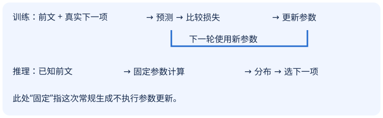

# 01｜模型、参数、训练：一次回答从哪里来

**模型把输入变成预测；训练修改参数；推理使用参数。聊天产品还需要把模型接到消息、资料和工具上。** 先分清这三件事，后面看到一个矩阵或一次 API 调用时，才知道它在流程的哪个位置。

本章不要求机器学习知识，只要求能读懂变量、数组和函数调用。学完请能画出两条不同的数据流，并指出哪一步会改变参数。

## 1. 从一个补全文本的小程序开始

这节用一次下一项预测，说明我们究竟要模型输出什么。

假设输入是 `服务 超时`，候选下一项只有 `重试、成功、停止`。这里每个词暂当一个事先切好的记号，叫 token，读作“托肯”。真实文本怎样切分留到[第08章](08-tokenization.md)。人为给一个预测分布：

| 候选下一项 | 模型给出的概率 |
|---|---:|
| 重试 | 0.6 |
| 成功 | 0.3 |
| 停止 | 0.1 |

三个数相加是 `0.6+0.3+0.1=1`。若选最高概率，得到“重试”；若按概率抽样，也可能得到“成功”。概率是本次预测的数，**不是已核验的事实正确率**。即使“重试”概率为0.6，也不能据此判断实际系统应该重试。

模型的接口可以先写成：

```text
predict(prefix, parameters) → 下一个token的概率数组
```

`prefix` 是已经看见的前文，`parameters` 是模型保存的一组数。一次预测不是一次完整回答：把选中的“重试”接到前文，再调用一次，才能继续写。程序还需要停止条件，例如结束记号或最大生成长度。

## 2. 规则和学习，区别在数从哪里来

这节区分人为指定的行为与从数据调整的行为，不把模型当成神秘服务。

规则程序可以写 `if 最后一个词 == 超时: return 重试`。它清楚、便宜，也可能正好够用。学习模型则保留可调整的数，用历史例子决定这些数应怎样变化。两者都是计算程序，差别不在“有没有代码”，而在行为的哪些部分由数据调整。

给一个最小计算，暂不要求它就是完整语言模型。输入 `x=2`，参数 `w=0.5`、`b=-0.2`，输出分数是：

```text
0.5×2−0.2 = 1−0.2 = 0.8
把w改为0.6：0.6×2−0.2 = 1.0
把输入改为3、保持原参数：0.5×3−0.2 = 1.3
```

`x` 读“艾克斯”，是本次输入；`w` 读“达不溜”，是输入的权重；`b` 读“比”，是额外加的偏置；`z` 读“泽德”，是原始分数。一般写作 `z=w×x+b`。上面的0.8不是概率，怎样把多个分数变成概率见[第02章](02-math.md)。

输入换了，输出会换，但参数未必换。训练则会换参数，保存后影响未来很多输入。工程上可以把参数看成与程序一起版本管理的数据文件；它们并不是编译生成的机器指令，也不是一条条可直接读出的业务规则。

## 3. 两条数据流，别画成一条

这节把训练与推理的接口画开，带走“有答案供比较”和“没有未来答案”这一关键差别。



| 对象 | 在小程序中是什么 | 通常何时变化 |
|---|---|---|
| 参数 | 权重、偏置、词向量表 | 训练更新时 |
| 输入 | 当前前文 | 每次请求、每步生成 |
| 中间结果 | 分数、概率 | 每次计算 |
| 超参数 | 学习率、层数、窗口长度 | 实验设计时由人选择 |

训练时，可以从已有文本 `A B C` 构造 `A→B`、`A B→C`；因为原文已在手，目标是已知的。推理时只拿到 `A`，必须先预测B才能继续。模型不能看到真实未来再假装预测。训练的罚分叫“损失”，[第03章](03-counting.md)会用实际概率计算；怎样据此更新数值见[第05章](05-gradients.md)。

## 4. 把模型放回产品中

这节说明模型的技术位置，以及一次回答还依赖哪些环节。

AI是人工智能领域，机器学习是从数据改善行为的一类方法；深度学习主要用深层神经网络学习表示。Transformer是一种神经网络架构，许多大语言模型采用它。LLM是大语言模型这个类别，GenAI指生成内容的方向；AI不等于LLM，机器学习也不等于神经网络。

技术关系可读成这些带含义的边：`深度学习—属于→机器学习`，`语言模型—可采用→Transformer`，`聊天产品—使用→语言模型`。不要据此把“产品”和“架构”画成同一层的竞争选项。

分析任务还应另问五件事：输出要什么；手里能用哪些数据；训练依据从哪来；怎样评价且有什么约束；最终系统怎样接入。以补全例子作答：输出下一token分布；只用已知前文；训练目标来自原文下一项；看保留数据的预测损失和资源约束；最后再决定界面与调用方式。这五问不是模型家族的包含链。

聊天产品可能在调用前取回资料，调用后检查引用，或申请工具执行。检索出的资料是本次输入；默认不会因放入上下文就永久写进参数。对话越长，也不意味着权重越大。

## 5. 纸上追踪与故障定位

这节让你实际检查状态变化，避免用“模型学到了”解释所有变化。

拿纸写三列：参数、输入、输出。先填 `w=0.5,b=-0.2,x=2,z=0.8`。第二行仅把输入改为3，输出1.3；第三行固定输入3，把w改为0.6，输出1.6。圈出真正修改参数的那一行。这个练习不运行训练，也不能证明参数是从数据学出的。

失败例：把验证文档加入提示后答对一个问题，就宣称“训练成功”。实际只改变了输入；更可能是答案证据进入了可见上下文。另一失败是只记住训练文本，在新文本上仍差；这必须靠分开的数据检查，不能靠看一条流畅回答排除。

## 小测

1. 参数不变，输入从2变成4，原例分数是多少？这算训练吗？

<details><summary>展开答案</summary><p>0.5×4−0.2=1.8。只是重新计算输出，没有修改w、b，不算参数训练。</p></details>

2. 从文本 `A B C D` 训练下一项预测，输入 `A B` 时，目标是B还是C？为什么？

<details><summary>展开答案</summary><p>是C。B已经在输入中；让模型复制B容易得到好看的结果，却没有训练“预测下一项”这个任务。</p></details>

3. 产品先搜索文档，再让模型回答，答案改善能证明模型权重改变了吗？应检查什么？

<details><summary>展开答案</summary><p>不能。先检查参数文件版本是否变化、是否执行更新步骤；同时记录本次可见文档。输入证据变化和参数变化是两条不同原因。</p></details>

下一章：[用向量、矩阵和softmax把一次预测算清楚](02-math.md)。
