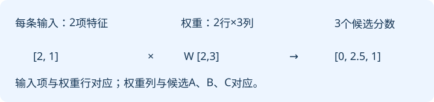

# 02｜向量、矩阵与概率：先把一次计算看懂

**向量是一组有顺序的数，矩阵是按行列组织的数；形状决定能怎样计算。softmax把一组原始分数变成总和为1的概率。** 你不必先学完整线性代数，但要能检查每个轴是什么。

前置：[第01章](01-models.md)的输入、参数和输出。本章用手设数字，只解释计算，不声称这些数经过训练。阅读目标是拿笔完成一次矩阵乘法，区分“概率归一化”和“取最大值”。

## 1. 为什么不用一个数代表所有信息

这节把数组的工程直觉接到向量上，带走“同一位置始终表示同一类信息”。

暂把前文表示为两项数 `[2,1]`。我们不解释它们已学出了什么语义，仅约定这是两个输入特征。候选下一项A的两个权重是 `[0.5,-1]`，于是：

```text
输入第一项×第一项权重 = 2×0.5 = 1
输入第二项×第二项权重 = 1×(-1) = -1
把两项相加 = 1+(-1) = 0
```

这叫点积。`x`读“艾克斯”，表示输入向量；`w`读“达不溜”，表示同长度的权重向量；下标1、2读“第一项、第二项”；点号`·`读“点乘”。写成 `x·w=x₁w₁+x₂w₂`。若把输入顺序换成 `[1,2]`，同一组权重得到 `1×0.5+2×(-1)=-1.5`。**交换数组元素会改变含义和结果。**

## 2. 多个候选一起算，就是矩阵运算

这节让你检查输入轴和输出轴，带走“每一列对应一个输出分数”的本章约定。

要同时给A、B、C打分，就把三组权重并排。约定输入是行向量，计算时从左向右乘：

```text
x = [2,1]                 形状[1,2]
W = [[ 0.5, 1, 0],
     [-1.0, 0, 2]]       形状[2,3]
b = [0, 0.5, -1]         形状[3]

A分数 = 2×0.5 + 1×(-1) + 0   = 0
B分数 = 2×1   + 1×0    + 0.5 = 2.5
C分数 = 2×0   + 1×2    − 1   = 1
z = [0,2.5,1]            形状[1,3]
```

大写 `W`读“达不溜矩阵”，小写 `b`是偏置向量，`z`是输出分数向量。一般写 `z=xW+b`。中间维度2必须相同：两个输入特征，各自贡献给三个候选。

若两条输入一起算，`X=[[2,1],[0,1]]`形状为`[2,2]`，结果第二行是`[-1,0.5,1]`。第一维2是样本数，第二维2是特征数，虽然数值相同，职责不同。把样本轴当成特征轴，程序可能恰好能乘，但含义已错。



PyTorch的线性层把权重存成 `[输出维,输入维]`。所以数学里本章的W，对应代码层权重的转置；转置读作“交换行与列”，记为上标T。别只看变量都叫weight就直接相乘。[第07章](07-training.md)会核对接口。

## 3. 从“分数”到“概率”缺哪一步

这节用三个小数值手算softmax，带走它改变比例、保留排序的作用。

分数可以是负数，和也不必为1，不能直接拿来抽样。先用更好算的一组分数 `[0,ln2,ln3]`。`ln`读“自然对数”，是指数的反操作，所以 `e⁰=1`、`e^(ln2)=2`、`e^(ln3)=3`；`e`读“自然常数”，约2.718。

```text
先指数化：[1,2,3]
再算总和：1+2+3=6
最后逐项除总和：[1/6,2/6,3/6]
概率：[0.1667,0.3333,0.5]
```

这个操作叫softmax，读作“索夫特麦克斯”。`zⱼ`读“第j个分数”，`pⱼ`读“第j个概率”，`j`是候选下标；`Σₖ`读“对所有候选k求和”。公式为 `pⱼ=e^(zⱼ)/Σₖe^(zₖ)`。刚才j为C时，就是 `3/6=0.5`。

softmax不是只留下最大项。它给三个候选都保留概率；`argmax`才是取最大项的下标。这是两个不同操作。

| 输入分数 | 指数比例 | 输出概率 |
|---|---|---|
| [0,0,0] | [1,1,1] | [1/3,1/3,1/3] |
| [0,ln2,ln3] | [1,2,3] | [1/6,2/6,3/6] |
| [ln2,ln4,ln6] | [2,4,6] | [1/6,2/6,3/6] |

最后两行说明：所有分数加上同一个常数ln2，结果不变。计算机利用这个性质，先减去最大分数，避免指数溢出。例如 `[1000,1001,1002]`先变成`[-2,-1,0]`，再指数化。直接计算 `e^1002` 会出问题；减去最大数没有改变预测分布。

## 4. 条件概率中的竖线是什么意思

这节把概率与已知前文绑定，带走“改变条件就可能改变答案”。

若三次看见A后面分别接B、B、C，未平滑的经验频率为 `B:2/3,C:1/3`。写 `P(B|A)=2/3`，读“已知前一个是A，下一个是B的概率”。大写P表示概率，竖线表示“在已知……条件下”。这不是 `P(A|B)`，也不是B在所有位置中的总频率。[第03章](03-counting.md)会完整构造计数模型。

一次模型输出0.6，不等于“长期实测60%”；要验证概率是否与真实频率相符，还要收集独立样本。更不能把“下一个token像训练文本”偷换成“生成内容一定真实”。

## 5. 用标准库检查你的手算

这节让你在没有张量库时核对归一化，先预测输出再运行。

在课程根目录执行 `python3 labs/foundations.py` 可检查课程的基础数值例子；以下独立片段也可存成临时脚本运行：

```python
import math
z = [0.0, math.log(2), math.log(3)]
m = max(z)
e = [math.exp(v - m) for v in z]
p = [v / sum(e) for v in e]
print(p, sum(p))
```

`[]`是列表；`for v in z`依次读取每个元素；`math.exp`计算指数。预期概率接近 `[1/6,2/6,1/2]`、和接近1，浮点数末位允许有舍入误差。若你得到三行概率各为1，请检查是否错误地分别归一化了每个单独数字。

## 小测

1. `x=[1,2]`，W和b用第2节的数，三个分数分别是多少？

<details><summary>展开答案</summary><p>A=1×0.5+2×(-1)=-1.5；B=1×1+2×0+0.5=1.5；C=1×0+2×2−1=3。输出仍是三个候选分数，还不是概率。</p></details>

2. 分数是 `[ln2,ln2,ln4]`，softmax是多少？取最大值又得到什么？

<details><summary>展开答案</summary><p>指数为2、2、4，和8，概率为0.25、0.25、0.5。取最大值下标得到C；它不会保留完整分布。</p></details>

3. 输入形状是 `[4,2]`，数学W为 `[2,3]`，结果形状是什么？若softmax沿第一维算有什么问题？

<details><summary>展开答案</summary><p>结果[4,3]，四条输入每条三个分数。下一项预测需沿每条输入的三个候选归一化；沿第一维会让不同样本互相争概率，无法解释为单条输入的候选分布。</p></details>

下一章：[用文本计数做出第一个语言模型](03-counting.md)。
