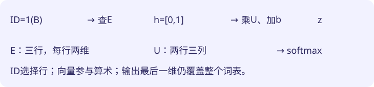

# 04｜把计数表换成参数：一次神经网络前向

**可训练模型先用参数给候选打分，再转成概率。one-hot乘矩阵等于取出一行；词向量查表让多个候选共享更小的表示空间。** 本章只算前向，数值都是手设参数；“能算出概率”还不意味着“已经学会”。

前置：[矩阵与softmax](02-math.md)、[计数语言模型](03-counting.md)。目标是从一个token ID追踪到整张词表的分数，指出哪些数会被训练修改。

## 1. 计数表保留任务，换掉数的来历

这节说明为什么引入参数，并带走“输入输出契约可以保持不变”。

计数模型看到A后给B较高概率，是因为A→B出现得多。现在仍输入A，仍输出A/B/C的概率，但先保存三行可调整分数：

| 输入token | 给A的分数 | 给B的分数 | 给C的分数 |
|---|---:|---:|---:|
| A | 0 | ln3 | ln2 |
| B | 0 | 0 | 0 |
| C | 0 | 0 | 0 |

A行经过softmax，指数为 `[1,3,2]`，总和6，概率 `[1/6,1/2,1/3]`，与上章平滑计数相同。这里把对应数字写进表，只是复现一次分布，不是执行了学习。后续训练不必把表格内容解释为次数，它们可以是任意实数。

直接分数表足以处理小bigram，为何还要继续？如果词表很大，完整表需要“词表大小平方”个数；而且每一行几乎各学各的，无法通过中间表示共享规律。是否真的需要复杂模型，要等保留数据比较；不能因“神经”二字直接判胜。

## 2. one-hot不是给token规定数值大小

这节解释ID与独热编码的差别，带走“ID是索引，不是距离”。

约定A/B/C的ID分别是0/1/2。输入B可以写成三维向量 `[0,1,0]`，只有对应位置是1，这叫one-hot，中文称独热编码。

```text
x=[0,1,0]
M=[[1,2,3],
   [4,5,6],
   [7,8,9]]
xM=[0×1+1×4+0×7,
    0×2+1×5+0×8,
    0×3+1×6+0×9]=[4,5,6]
```

结果就是M的B行。`x`是独热行向量，`M`是参数表；一般式 `z=xM` 对应“按ID取行”。实际程序可直接索引，不必真的创建满是0的长向量。

错误替代方案是把ID直接当一个连续特征。若分数为 `2×ID`，B得2、C得4；只是重新编号就改变预测，还无故假定C比B“大一倍”。独热/查表不要求ID有这种度量意义。重排ID时同步重排参数行，行为可以保持一致。

## 3. 用两张小表连接输入和输出

这节手算嵌入查表与输出层，带走“输入表示维度不等于词表大小”。

词表仍有三项，改用每项两个数表示。下面是局部教学模型，与后面完整decoder的宽度不同：

```text
嵌入表E：A=[1,0]，B=[0,1]，C=[1,1]
输入B → 查E的第1行 → h=[0,1]
输出权重U=[[0,1,0],
           [0,0,1]]
偏置b=[0,0,0]
分数z=hU+b=[0,0,1]
指数=[1,1,2.718282]
总和≈4.718282
概率≈[0.211942,0.211942,0.576117]
```

`E`读“嵌入表”，英文embedding，指可训练的向量查表；`h`读“艾尺”，是当前输入的内部表示；`U`读“优”，是输出权重；`b`是输出偏置。公式 `h=E[input_id]`、`z=hU+b` 分别对应查表与线性输出层。形状为 `E:[3,2]`、`h:[1,2]`、`U:[2,3]`、`z:[1,3]`。



E和U都可训练，不是只训练最后一层。偏置b也是参数，但不是矩阵：它不乘输入，对每个样本加同一组候选基础分。完整decoder后面采用无偏置词表头，本章带偏置的局部例只是帮助辨别两类参数，不要把配置直接拼过去。

查到同一个B，h也相同；这个最小模型仍只看一个token。嵌入本身不会凭空看到更早的文本，必须另设计上下文计算。

## 4. 参数数目和容量并非越少越好

这节比较存储和表达的代价，带走“两层线性表并非无损压缩”。

本例直接表有 `3×3=9`个数；嵌入加输出加偏置有 `3×2+2×3+3=15`个，反而更多。若词表1000项、表示宽度32，则直接表100万项，E与U共64000项，加偏置1000项，总共65000项。

节约来自中间维度小。代价是有效分数表被限制为两个小矩阵的乘积，未必能表示任意完整大表。参数共享有时帮助泛化，有时容量不足；需要验证，不是“压缩后一定更聪明”。隐藏层怎样增加表达能力，见[第06章](06-backprop.md)。

## 5. 把前向写成可以检查的代码

这节用普通Python对应手算，带走“运行前先写形状和预期”。

```python
E = [[1, 0], [0, 1], [1, 1]]
U = [[0, 1, 0], [0, 0, 1]]
b = [0, 0, 0]
h = E[1]  # Python索引从0开始；1是B
z = [sum(h[i] * U[i][j] for i in range(2)) + b[j]
     for j in range(3)]
print(h, z)
```

预期输出 `[0,1]`与`[0,0,1]`，不是完整训练结果。`range(2)`枚举0、1；外层遍历三个输出候选，内层把两个输入贡献相加。

故障例：把输出维度也设为2，得到两个概率就无法给C打分。表示向量可以是两维，输出词表却仍有三项。另一故障是只保存E，忘记U和词表ID映射；相同向量搭配不同输出权重或编号会产生不同预测，无法复现实验。

## 小测

1. 用第3节的参数输入A，分数与概率是多少？

<details><summary>展开答案</summary><p>h=[1,0]，z=[0,1,0]，指数[1,e,1]，概率约[0.211942,0.576117,0.211942]。查到另一行，最高项改成B。</p></details>

2. 词表4项、向量宽度3、输出带偏置，共有多少参数？输入ID算参数吗？

<details><summary>展开答案</summary><p>E有4×3=12，U有3×4=12，b有4，总计28。某次输入ID是数据索引，不是被梯度更新的模型参数。</p></details>

3. 同一个token B出现在两个不同句子中，这个模型会给出不同分布吗？应改哪里？

<details><summary>展开答案</summary><p>不会。它只读取B的ID，同一行E连接同一U和b。要让前文影响输出，必须增加读取上下文的计算；只扩大B向量并不能自动带入没有输入的信息。</p></details>

下一章：[用损失指引一次参数更新](05-gradients.md)。
