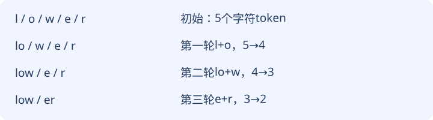

# 08｜字符、子词与BPE：文本怎样变成ID

**token是分词器产生的序列单位，ID只是词表索引。字符切分容易检查，子词切分能缩短常见片段；切分规则和词表必须与模型一起固定。** token不是天然等于一个字、一个词或固定字节数。

前置：[第04章的查表](04-parameters.md)。学完请能手工执行两轮合并，说明编码与解码边界，并找出数据泄漏和空格丢失的故障。

## 1. 为什么模型不直接读取字符串

这节把文本接口接到数值模型，带走分词器决定序列长度和词表含义。

模型的嵌入表需要整数索引。`服务超时`可以逐字符切成`服/务/超/时`，也可以切成`服务/超时`；前者4个token，后者2个。模型结构都可以处理整数序列，但词表、嵌入行与训练目标不同，不能直接互换。

| 方案 | 优点 | 代价 |
|---|---|---|
| 字符 | 实现直观，中文字符边界可见 | 序列较长；未见字符仍需策略 |
| 完整词 | 常见完整词较短 | 新词、拼写变化需要回退 |
| 子词 | 常见片段合并，稀有片段拆开 | 需要固定规则和词表；并非自然语义单位 |

本课程CPU训练主线使用字符级：从训练文本收集字符，排序后编号；ID 0预留UNK未知项、ID 1预留EOS结束项，字符从2开始。假设训练字符只有A/B/C，映射为A→2、B→3、C→4，则`AB`加结束项得到`[2,3,1]`。数字3不代表B“比A大1个单位”，只用来查表。

UNK把不同未知字符合并成同一项，解码后无法恢复原字符。这是明确的信息损失。EOS不是普通字面文本“EOS”的三个字母；它是程序预留的特殊token。课程没有PAD填充token，不能把0误当PAD。

## 2. BPE怎样逐轮合并

这节从相邻字符计数执行BPE，带走“学习合并规则”和“训练神经网络”是两件事。

BPE读字母“比、皮、伊”，英文Byte Pair Encoding。本节实现以字符起步，只演示相邻片段合并的核心思想，不是完整字节级生产分词器。

训练文本固定两组：`low low lower`、`new newer low`。空格作为独立token保留，**任何包含空白的相邻对都不参与合并**；两组之间也不计相邻对。初始每个字符一项。

先数能合并的相邻对：`l,o`出现4次，`o,w`也4次；`e,w`2次，`n,e`2次，`e,r`2次，`w,e`2次。并列最高时按“token字符串对的字典序”选最小项，因此第一轮选`l,o`。

| 轮次 | 被选相邻对 | 当前计数 | 合并后的新片段 |
|---|---|---:|---|
| 1 | l + o | 4 | lo |
| 2 | lo + w | 4 | low |
| 3 | e + r | 2 | er |
| 4 | e + w | 2 | ew |

每一轮都对**已经合并后的序列重新计数**。例如第一轮的`lo,w`在初始字符序列中根本不是一对；必须先生成lo才能在第二轮数到它。第三轮时`e,r`、`e,w`、`n,e`都为2，按字典序选`e,r`；合并后重新数，第四轮选`e,w`。



合并只换分段，不凭空删字符。`low/er`重新拼接仍是`lower`。学习规则靠训练集的片段频率，神经网络训练靠预测损失调整浮点参数；BPE合并计数不是梯度下降。

## 3. 新文本不能再偷偷学习规则

这节在固定规则下编码未见文本，带走编码顺序与未知字符的处理边界。

新文本`lowest new`先切字符，再依次应用四条已学规则：

```text
初始：l/o/w/e/s/t/空格/n/e/w        10项
l+o：lo/w/e/s/t/空格/n/e/w          9项
lo+w：low/e/s/t/空格/n/e/w          8项
e+r：没有匹配，保持8项
e+w：low/e/s/t/空格/n/ew            7项
```

这里s、t没有出现在训练字符中。演示程序仍把它们作为字符字符串返回，因此它展示的是**切分**，并没有证明存在可供模型查表的s/t ID。要真正输入固定词表的网络，还必须规定UNK回退或完整字节覆盖等策略。本课程字符训练器采用前者；不能拿本章字符串演示冒充无限覆盖的生产编码器。

合并规则有顺序。如果在训练时用一种并列选择方式，加载时换另一种，可能得到不同token序列。保存tokenizer需要至少固定初始单位、文本规范化、空白策略、词表、特殊ID和合并序列；仅保存“最终词表大小”不够。

## 4. 运行并检查空白没有消失

这节执行确定性实验，带走可复核的合并轨迹。

在课程根目录运行：

```bash
python3 labs/tokenization.py
```

本次实际运行得到四轮`l+o(4)、lo+w(4)、e+r(2)、e+w(2)`；测试token为`["low","e","s","t"," ","n","ew"]`。两个训练组输出长度分别为6和8，总14项；原字符总数是13+13=26，序列缩短12项。这个数只描述当前文本和规则，不能推成所有语言的压缩比例。

检查源码`encode`时，注意它按学习到的合并顺序应用规则。可在交互Python中试：

```python
from labs.tokenization import learn_bpe, encode
merges, _, _ = learn_bpe(['low low lower', 'new newer low'])
pieces = encode('low  new', merges)
print(pieces)
print(''.join(pieces) == 'low  new')
```

预期拼接比较为True，中间两个空格都保留。若你先用不带参数的字符串`.split()`再用单个空格拼回去，多空格与换行可能被改掉。对代码、日志、Markdown，这种改动可能改变含义。

## 5. 切分选择会改变怎样的比较

这节说明不同token口径不能直接比CE，带走分母需要一起报告。

假设同一段文字，字符方案有10个预测目标，总负对数概率20，则CE=2；子词方案有5个目标，总负对数概率15，则CE=3。按token均值会说2小于3，但token定义已变，不能直接据此判字符模型更好。跨分词器比较要选择一致文本单位或明确换算方法；本课程模型与计数基线用同一词表、同一目标窗口比较。

真实tokenizer还可能处理Unicode规范化、预切分、字节回退、特殊记号识别；本实验没有实现这些环节。不要用它估算某商业模型的计费token数，也不要假定所有中文词都被完整合并。模型与tokenizer版本要成套匹配。

## 小测

1. 在`a b`中，若本章规则只允许非空白合并，能把整段合成一个token吗？

<details><summary>展开答案</summary><p>不能。a与b之间没有直接相邻关系，包含空格的对又被排除。应保留a、空格、b；不能为得到短序列删除空白。</p></details>

2. 合并表依次为(a,b)、(ab,c)，新文本`abc ab`如何切分？

<details><summary>展开答案</summary><p>字符起点a/b/c/空格/a/b；第一轮ab/c/空格/ab；第二轮abc/空格/ab，共3项。规则只应用，不从新文本重新统计或新增合并。</p></details>

3. 字符模型词表没有Ω，程序切分出字符串Ω，是否表示模型一定可以处理它？

<details><summary>展开答案</summary><p>不表示。字符串片段还需映射到固定ID。课程训练器会映射UNK并失去原字符信息；只有明确实现相应覆盖/回退的tokenizer才能保证另一种行为。</p></details>

下一章：[固定窗口与平均为什么仍然不够](09-context.md)。
