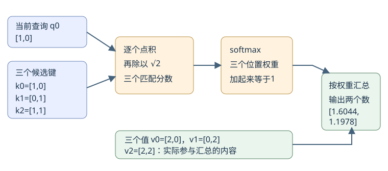
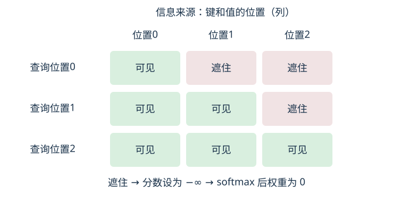

# 10｜注意力：让每个位置按内容取信息

注意力做的事是：**对每个位置，先比较它与可见位置的匹配分数，再按这些分数分配权重，最后汇总那些位置提供的数值。** 本章会亲手算出一次汇总结果，并用“修改未来输入”的实验检查信息有没有越界。

适合读者：会读数组和循环，但还没学过机器学习。只需加减乘除；开平方和指数会给出近似值，可用计算器核对。正文中的片段、向量和参数全部人为给定，不需要下载模型，也没有训练步骤。

完成后，你应该能做到三件事：从三个二维数组算出注意力的一行输出；解释 Q、K、V 分别在哪一步起作用；预测修改未来位置后，哪些输出应该保持不变。会复述三个英文缩写还不算完成。

## 1. 为什么不能只把三个位置平均一下

这节要解决“为什么要按内容取信息”，读完能说明固定平均少了哪一种能力。

先定位：人工智能（AI）是宽泛领域，机器学习（ML）研究从数据学习规律的方法，深度学习（DL）主要使用深层神经网络；Transformer 是一种神经网络架构，许多大语言模型（LLM）采用它。注意力是其中负责位置间信息汇总的机制之一；本章只拆开这个机制，尚未组成一个能生成文字的语言模型。

我们使用三个已经分好的示意片段：

| 位置编号 | 示意片段 | 人为给定的输入表示 |
|---|---|---|
| 0 | 服务 | [1, 0] |
| 1 | 超时 | [0, 1] |
| 2 | 重试 | [1, 1] |

编号从 0 开始，像数组下标。三个片段只是让位置容易辨认，**不代表真实分词器一定这样切词**；两个数也不表示“服务程度”或“超时概率”，没有经过训练来获得这些语义。

假设每个位置都需要从这三个位置取一些信息。最简单的方法是每个位置都取三分之一。这样，无论当前处理位置 0 还是位置 1，只要被汇总的三个数组相同，结果就相同。

例如，后面真正要汇总的三个数组会是 `[2,0]`、`[0,2]`、`[2,2]`。固定平均的两个坐标分别为：

```text
第一个坐标：(2 + 0 + 2) / 3 = 4 / 3 ≈ 1.3333
第二个坐标：(0 + 2 + 2) / 3 = 4 / 3 ≈ 1.3333
所以每个位置都拿到 [1.3333, 1.3333]。
```

这并不是算错了。固定平均能够汇总信息，但它没有根据“当前位置的内容”调整取用比例。我们想增加的能力是：位置 0 和位置 1 可以形成不同的权重，从同一组候选内容中取出不同的组合。

注意力因此把固定的三分之一替换成**根据当前输入算出的权重**。它通常不是只选中一个位置，而是让多个可见位置按不同比例共同提供信息。

## 2. 先补一座小桥：两个数怎样被加权汇总

这节把“向量”和“加权和”落到数组运算，读完能逐坐标算出一个新数组。

`[2,0]` 是一个二维向量：按固定顺序排列的两个数。“维”在这里就是坐标的数量。你可以先把向量理解成长度为 2 的数值数组；前后计算必须保持坐标顺序一致。

权重 `0.25` 乘以向量 `[2,0]`，意思是两个坐标各乘一次。两个向量相加，意思是对应坐标相加：

```text
0.25 × [2,0] = [0.5,0]
0.75 × [0,2] = [0,1.5]
[0.5,0] + [0,1.5] = [0.5,1.5]
```

这就是加权和：每份内容先乘自己的比例，再把对应坐标相加。权重为 `0.25` 和 `0.75` 时，总和为 1；因此这次计算也是加权平均。它不是把数组拼接成 `[0.5,0,0,1.5]`，输出仍然只有两个坐标。

下面把比例改成 `0.5` 和 `0.5`。先自己算，再展开核对。

<details>
<summary>手算：两个位置各占一半，输出是什么？</summary>
<p>第一份：0.5 × [2,0] = [1,0]。</p>
<p>第二份：0.5 × [0,2] = [0,1]。</p>
<p>逐坐标相加：[1+0,0+1] = [1,1]。内容没变，只改比例，输出就从 [0.5,1.5] 变成 [1,1]。</p>
</details>

稍后用小写 `v`（读作“V”）表示一份待汇总的向量，用 `a`（读作“诶”）表示它的权重，用 `o`（读作“欧”）表示输出。下标是位置编号，例如 `v0` 指位置 0 的向量，不是第一个坐标。刚才的运算可写成：

```text
o = a0 × v0 + a1 × v1
  = 0.25 × [2,0] + 0.75 × [0,2]
  = [0.5,1.5]
```

本章的核心问题由此变得明确：**这几个 a 应该怎样从输入计算出来？**

## 3. Q、K、V：同一位置的三种工作

这节解释为什么要把输入转成三组向量，读完能区分“用来匹配”与“拿去汇总”的数值。

先看位置 0。它的输入 `[1,0]` 会生成三份表示：`q0=[1,0]`、`k0=[1,0]`、`v0=[2,0]`。前两份参与匹配，第三份才是被加权汇总的内容。

| 名称与读法 | 本章中的工作 | 位置 0 的值 |
|---|---|---|
| Q，读作“Q”，Query，查询 | 当前处理位置拿它与每个候选位置比较 | q0 = [1,0] |
| K，读作“K”，Key，键 | 候选位置拿它参与匹配，产生分数 | k0 = [1,0] |
| V，读作“V”，Value，值 | 候选位置实际提供给汇总步骤的内容 | v0 = [2,0] |

同一个位置既可能是当前查询者，也可能是别的位置取信息的来源，因此它同时有 Q、K、V 三种角色。它们不是三段不同的文字，也不是三个注意力头。

### 从输入生成三份表示

这一步要看懂的是“同一个输入可以通过三套参数生成三种表示”，先跟着位置 2 算一次。

位置 2 的输入是 `[1,1]`。生成 Q 和 K 时保持不变，生成 V 时两个坐标都乘 2，得到 `[2,2]`。全体数值如下：

| 位置 | 输入 x | 查询 q | 键 k | 值 v |
|---|---|---|---|---|
| 0 | [1,0] | [1,0] | [1,0] | [2,0] |
| 1 | [0,1] | [0,1] | [0,1] | [0,2] |
| 2 | [1,1] | [1,1] | [1,1] | [2,2] |

把三行输入排在一起叫矩阵 `X`（读作“X”），Q、K、V 则分别是三行查询、键和值组成的矩阵。这些矩阵都是三行两列：三个位置，每个位置两个坐标。

通常会使用三套“投影参数”生成它们。投影在这里就是对坐标做带参数的线性组合，不是把图像投到屏幕。本章故意选最简单的参数，让你把精力放在后续的信息流上。

`WQ`、`WK`、`WV` 分别读作“W Q”“W K”“W V”，是三套投影参数矩阵。它们的具体值为：

```text
WQ = [[1,0],     WK = [[1,0],     WV = [[2,0],
      [0,1]]           [0,1]]           [0,2]]
```

前两者叫单位矩阵：用它做变换，输入保持不变。第三者是单位矩阵的 2 倍。以一个行向量右乘 WV 为例，先用位置 2 的数字计算，再看一般规则：

```text
[1,1] 变换后的第一个坐标 = 1×2 + 1×0 = 2
[1,1] 变换后的第二个坐标 = 1×0 + 1×2 = 2
所以 [1,1] × WV = [2,2]
```

这里的 `×` 对两个数字表示普通乘法，对行向量与矩阵表示刚才逐列计算的操作。于是三组表示可以简写为：

```text
Q = X × WQ = X
K = X × WK = X
V = X × WV = 2X
```

**本例 Q 和 K 数值相同，是我们选择参数的结果，不是注意力的定义。** 真实训练中可以学习出不同的 WQ、WK、WV。本章只使用给定值，不能据此声称模型已经知道“超时导致重试”。

### 看一条计算路径

这张图沿位置 0 的查询展示两条分工：Q/K 产生权重，V 根据权重参加汇总。



图中 V 不参与这一层的匹配打分，但它仍来自输入；改变某个位置的输入，可能同时改变该位置的 K 和 V。

## 4. 手算位置 0：匹配分数怎样变成输出

这节完整走通一行注意力，读完能从 q0、三个 k 和三个 v 算到输出两个数。

先暂时允许每个位置查看全部三个位置，稍后再加“不能看未来”的限制。当前查询固定为 `q0=[1,0]`。

### 第一步：用点积给三个位置打分

这一步用对应坐标相乘再相加，把两个数组的匹配结果压成一个数。

先算 q0 与 k2：`1×1 + 0×1 = 1`。这个操作叫点积，用中间一个点 `·` 表示，读作“点乘”。另外两个候选位置也按同一方法计算：

| 当前查询 | 候选键 | 两个坐标逐项计算 | 点积结果 |
|---|---|---|---:|
| q0=[1,0] | k0=[1,0] | 1×1 + 0×0 | 1 |
| q0=[1,0] | k1=[0,1] | 1×0 + 0×1 | 0 |
| q0=[1,0] | k2=[1,1] | 1×1 + 0×1 | 1 |

一般地，`q=[a,b]`、`k=[c,f]` 中，a、b、c、f 分别是两个数组的坐标值，读法就是英文字母名。那么 `q·k = a×c + b×f`。例如本表最后一行是 `a=1,b=0,c=1,f=1`。

此处较大的点积会获得较大的后续权重，但不要把它直接叫“语义相似度”。向量长度也会影响点积；我们没有把这些向量训练成语义表示。

### 第二步：除以向量宽度的平方根

这一步给分数做统一缩放，读完能区分“点积结果”和真正送进 softmax 的分数。

本章的查询和键各有两个坐标，宽度记作 `d`（读作“D”），因此 `d=2`。`√2` 读作“根号二”，意思是平方后等于 2 的正数，约 `1.4142`。

```text
位置0的分数：1 / √2 ≈ 0.7071
位置1的分数：0 / √2 = 0
位置2的分数：1 / √2 ≈ 0.7071
```

把这些分数依次排起来，得到 `[0.7071,0,0.7071]`。一般规则写作 `score = q·k / √d`；`score` 读作英文“score”，就是当前查询对某个候选键的缩放后分数。

为什么不直接用点积？维度增大时，在常见初始化假设下，点积的波动会增大，softmax 可能把权重压得过于集中。除以 `√d` 用来缓和这个尺度问题，并不保证任何输入都不会得到集中权重。在这里，它把 `1` 缩成了 `0.7071`；**它还没有把三个分数变成和为 1 的比例**。

### 第三步：softmax 把三个分数变成比例

这一步会把每个分数变成正数，再除以它们的总和，读完能核对三个权重是否加起来为 1。

softmax 读作“soft-max”。先了解其中的指数：`e`（读作“E”）是固定数，约为 `2.7183`；`e^s` 读作“e 的 s 次方”，其中 s 是一个分数。你可以先用计算器的 `exp` 功能，不需要在这节学习非整数次方怎样求。

本例要用到的值只有两种：`e^0=1`，`e^0.7071≈2.0281`。后者使用未舍入的 `1/√2` 计算；正文只把结果显示为四位小数。

```text
分数：              [0.7071, 0,      0.7071]
每项取指数：        [2.0281, 1,      2.0281]
指数值总和：         2.0281 + 1 + 2.0281 ≈ 5.0562
每项除以这个总和：  [0.4011, 0.1978, 0.4011]
```

因此，对当前查询 q0 来说，三个位置的权重约为 `40.11%`、`19.78%`、`40.11%`。它们表示**这次汇总分给各个位置的比例**，并不表示下一个词是“服务”“超时”“重试”的概率。

为便于读代码，再用位置下标写一次。`s0`、`s1`、`s2` 分别是三个位置的分数，`a0`、`a1`、`a2` 是相应权重：

```text
a0 = e^s0 / (e^s0 + e^s1 + e^s2)
   ≈ 2.0281 / (2.0281 + 1 + 2.0281)
   ≈ 0.4011
```

另外两项使用同一个分母。每个分子都在分母里恰好出现一次，所以三个权重相加为 1。分数 0 仍得到约 `0.1978` 的权重；**零分不代表禁止取信息**。

<details>
<summary>手算核对：位置1的权重，以及不缩放时的变化</summary>
<p>位置1的指数值为 e^0=1，因此其权重为 1/(2.0281+1+2.0281)≈0.1978。</p>
<p>如果这次不缩放，分数会是 [1,0,1]，指数值约为 [2.7183,1,2.7183]，总和约为 6.4366。</p>
<p>相应权重约为 [0.4223,0.1554,0.4223]。缩放没有改变分数大小顺序，但让本例的比例更均匀一些。不能把这一个小例的变化扩大为所有输入下的保证。</p>
</details>

### 第四步：按比例汇总 V

这一步把刚算出的三个权重乘到三个值向量上，读完能说明最终输出为什么还是二维数组。

我们仍使用 `v0=[2,0]`、`v1=[0,2]`、`v2=[2,2]`。输出不是三个分数，也不是三个权重，而是它们加权得到的两坐标向量。

```text
o0 = 0.4011 × [2,0] + 0.1978 × [0,2] + 0.4011 × [2,2]

第一个坐标 ≈ 0.4011×2 + 0.1978×0 + 0.4011×2
           ≈ 0.8022 + 0 + 0.8022 = 1.6044
第二个坐标 ≈ 0.4011×0 + 0.1978×2 + 0.4011×2
           ≈ 0 + 0.3956 + 0.8022 = 1.1978

o0 ≈ [1.6044,1.1978]
```

小写 `o0` 表示位置 0 的输出；下标 0 不是指输出的第一个坐标。实际程序用未舍入的权重算到底，显示位数不同可能造成最后一位差异。

从机制上看，q0 与 k0、k2 的分数相同，所以两处得到相同权重；它们提供的 V 却不同，分别是 `[2,0]` 和 `[2,2]`。**匹配分数相同，不代表提供的内容相同。**

目前我们只算了输出矩阵的一行。换成 q1 去与三个键比较，就会得到位置 1 的另一行；每一行都有自己的一组权重，分别加起来为 1。行对应查询位置，列对应被取信息的位置。

## 5. 因果遮罩：先禁止看未来，再分配比例

这节给计算加上可见范围，读完能算出前两行，并解释为什么不能用零分代替遮罩。

如果模型要按顺序生成，处理位置 0 时，位置 1 和位置 2 尚属于未来。训练时即便整个序列已放在内存里，也不能让当前位置靠后面的输入完成预测，否则训练题泄露了答案信息。

“因果”在这里指这个**信息可见方向的约束**，不表示证明了日志片段之间的因果关系。位置 i 可以看自己和之前的位置，不能看位置编号大于 i 的位置；例如位置 1 可以看 0 和 1，不能看 2。

### 哪一行可以看哪一列

这张图把查询位置画成行、信息来源画成列；每行只会汇总标为“可见”的列。



图中的下三角来自“允许看自己和之前的位置”。位置 0 的输入仍然是真正可见的当前输入；语言模型用当前位置的表示预测下一位置，不是要求位置 0 在完全没有输入时预测自己。

### 位置 0：剩下一个来源

这一步把未来两处的分数换成负无穷，读完能解释权重为什么变成 `[1,0,0]`。

`−∞` 读作“负无穷”，不是一个普通负数。在这里，它表示该位置完全不可见；对指数运算而言，分数趋向负无穷时，指数趋向 0。代码可以用负无穷值实现这一效果。

```text
原分数：       [0.7071, 0,   0.7071]
遮罩后分数：   [0.7071, −∞,  −∞]
取指数：       [2.0281, 0,   0]
归一化权重：   [1,      0,   0]
输出：          1×[2,0] + 0×[0,2] + 0×[2,2] = [2,0]
```

注意遮罩发生在 softmax **之前**。如果把不可见位置的分数设成 0，指数会是 1，仍然会取得信息；第 4 节中位置 1 的 `0.1978` 就是现成的反例。

### 位置 1：在两个可见来源之间重新分配

这一步改用 q1=[0,1]，读完能独立算出第二行输出。

先逐项点积，再缩放：

```text
q1·k0 = 0×1 + 1×0 = 0 → 缩放后为 0
q1·k1 = 0×0 + 1×1 = 1 → 缩放后约为 0.7071
q1·k2 = 0×1 + 1×1 = 1 → 缩放后约为 0.7071
```

位置 2 是未来，所以在 softmax 之前把第三项替换成 `−∞`。接着计算：

```text
遮罩后分数：  [0,      0.7071, −∞]
指数值：      [1,      2.0281, 0]
指数值总和：   1 + 2.0281 ≈ 3.0281
权重：        [0.3302, 0.6698, 0]

使用未舍入的权重继续计算：
第一个输出坐标 ≈ 0.330238451×2 + 0.669761549×0 + 0×2 = 0.6605
第二个输出坐标 ≈ 0.330238451×0 + 0.669761549×2 + 0×2 = 1.3395
所以 o1 ≈ [0.6605,1.3395]
```

遮罩并非从原先的权重里删掉一项就结束。它改变了参与 softmax 的位置范围，剩下的权重必须在可见范围内重新加起来为 1。

<details>
<summary>反例手算：先算完softmax再把未来权重乘0，会发生什么？</summary>
<p>以第4节的位置0为例，先得到 [0.4011,0.1978,0.4011]，再把后两项乘0，只剩 [0.4011,0,0]，权重总和约0.4011。</p>
<p>直接用它汇总，输出约 [0.8022,0]，而正确的因果输出是 [2,0]。可见，事后清零且不重新归一化，会丢失应有的比例。</p>
<p>本章选择在softmax之前处理遮罩，既禁止未来位置，又让可见位置的权重自然归一化。每行都保留自己，因此不存在一整行全被遮住的情况。</p>
</details>

## 6. 改掉未来输入：检验信息是否真的被挡住

这节用一次有明确预期的修改检验机制，读完能分辨“遮罩存在”和“遮罩真的生效”。

把位置 2 的输入从 `[1,1]` 改成 `[0,0]`，位置 0 和位置 1 保持原样。Q、K、V 必须都从新 X 重新计算，因此 `k2` 变成 `[0,0]`，`v2` 变成 `[0,0]`。三个位置仍然都是有效位置；`[0,0]` 只是人为替换的数值，不表示填充位置（PAD），也不会自动触发任何遮罩。

先别运行程序，写下你的预测：位置 0、位置 1 的输出会变吗？如果加了因果遮罩，它们不能取位置 2 的信息，答案应是“不变”。

| 版本与查询位置 | 修改前输出 | 修改未来输入后输出 |
|---|---|---|
| 因果遮罩，位置 0 | [2.0000,0.0000] | [2.0000,0.0000] |
| 因果遮罩，位置 1 | [0.6605,1.3395] | [0.6605,1.3395] |
| 无遮罩，位置 0 | [1.6044,1.1978] | [1.0070,0.4965] |

因果版本前两行不变有两层原因：当前查询 q0、q1 没改；它们看得见的 k0、k1 和 v0、v1 也没改。新 k2、v2 都在可见范围之外。

无遮罩版本位置 0 的变化则可以具体算出来：

```text
新的 q0·k2 = 1×0 + 0×0 = 0
新的分数 = [0.7071,0,0]
新的指数 = [2.0281,1,1]
新的权重 ≈ [0.5035,0.2483,0.2483]
用未舍入的权重汇总：
新的输出 ≈ 0.503489843×[2,0] + 0.248255078×[0,2] + 0.248255078×[0,0]
         ≈ [1.0070,0.4965]
```

这次修改既改变了未来位置的匹配分数，又改变了它能提供的内容。即使某个位置的新 V 为零，它仍可能凭借 K 分走其他位置的权重。**零向量不等于被遮住**；第三项依然占约 `0.2483`，就是数值证据。

位置 2 自己的输出没有“不变”的要求，因为我们改了它的输入。这个测试验证的是本次注意力计算中未来到过去的通路被切断，不是证明整个真实语言模型没有任何信息泄漏。

## 7. 运行实验：用打印结果逐步对账

这节把手算连接到可执行程序，读完能定位分歧发生在投影、分数、权重还是汇总步骤。

实验文件是 [attention.py](../labs/attention.py)，使用 CPU 和 Python 标准库，不需要安装第三方包、申请账号或下载模型。阅读页面见 [离线阅读页](../site/10-attention.html)。

在课程目录下执行：

```bash
python3 labs/attention.py
```

如果终端已经进入本章所在的 `chapters` 目录，使用：

```bash
python3 ../labs/attention.py
```

先运行 `python3 --version` 确认终端能找到 Python 3。如果提示找不到命令，需要先具备 Python 3 环境；这个问题与注意力数值无关。若提示找不到脚本，检查当前目录以及命令中的相对路径。

不要只找最后一行“成功”。按下面四步观察程序打印的中间结果：

1. 找到 Q、K、V。确认三行 Q 和 K 与输入相同，V 每个坐标都是输入的两倍。
2. 找到无遮罩的第 0 行。分数应约为 `[0.7071,0,0.7071]`，权重约为 `[0.4011,0.1978,0.4011]`，输出约为 `[1.6044,1.1978]`。
3. 找到因果计算的前两行。第 0 行权重应为 `[1,0,0]`；第 1 行第三个权重应为 0，并得到约 `[0.6605,1.3395]`。
4. 找到未来输入修改的对比。确认程序重新计算了全部 Q/K/V，且因果版本前两行保持不变，无遮罩版本第 0 行发生变化。

程序可能打印更多小数位。比较时先对齐查询行、遮罩开关和输入，再比较数值；不要把第 0 行的权重与第 1 行的输出拼在一起。

接着做一次主动操作：在脚本的输入定义处找到第三行，把 `[1,1]` 改成 `[0,0]`，保存为你自己的副本后运行。先在纸上写下前两行因果输出应当不变，再看结果。如果误改了第一行，查询 q0 本身就变了，不能再套用“不变”的预期。

| 看见的现象 | 优先检查什么 |
|---|---|
| V 与 X 完全相同 | 是否漏掉 WV 的 2 倍变换 |
| 位置 0 的未来权重仍大于 0 | 是否没有在 softmax 前使用负无穷遮罩 |
| 一行权重之和小于 1 | 是否在 softmax 后只清零，没有重新归一化 |
| 前两行因果输出随第三行变化 | 遮罩的行列方向是否反了，是否不小心修改了前两行 |
| 输出第三个数被当成词概率 | 检查打印对象：权重有三项，本例输出只有两项 |

本程序用布尔可见表直接让禁止位置的指数贡献为0，再对允许项归一化；它与本章“把分数设为负无穷再做softmax”的规则等价。不要把代码里这个指数分支，与“把原始分数设为0”混为一谈。

这段程序演示给定参数的前向计算，即输入经过固定运算得到输出。没有损失函数或参数更新，因此运行成功不表示训练出了语言模型。

## 8. 六个容易混淆的地方

这节集中澄清计算正确后仍可能形成的误解，读完能把注意力结果放回恰当的边界。

| 容易混淆 | 本章应保留的区分 |
|---|---|
| Q、K、V 只是三个名字 | Q/K 决定匹配和权重；V 决定被汇总的内容。Q=K 只是本例选择 |
| 权重是词表概率 | 本章每行三项权重对应三个输入位置；词表概率对应所有可输出的 token，是另一层计算 |
| 输出向量是概率 | `[1.6044,1.1978]` 是两个表示坐标，能超过 1，也不要求和为 1 |
| 因果遮罩提供了位置坐标 | 遮罩限制谁能看谁；显式表达先后和距离通常还需要位置相关机制，两者工作不同 |
| 内容相关权重解释了模型理由 | 权重只描述这一步如何汇总 V；不能凭较大权重断言人类语义上的理由，更不能建立因果证据 |
| 这是一个完整 Transformer | 本章只有单头注意力的局部计算，未加入多头组合、残差、归一化、前馈网络和输出词表等环节 |

为何遮罩不等于位置坐标？本例第 0 行能看一个位置，第 1 行能看两个，遮罩确实引入了方向限制；但“允许看位置 0 和 1”与“向量中编码了相隔多远”是不同信息。不能从遮罩存在推断模型已经获得完整的位置表示。

还有一个名称陷阱：语言模型的最终输出层也常用 softmax，但它把词表里各候选 token 的分数变成分布。本章 softmax 的输入是**当前查询对各输入位置的分数**，输出用于汇总 V；对象和用途不同。

如果只是想证明“服务超时后需要重试”，这组人为参数没有提供这样的证据。更大的权重只来自我们明确给出的数字与运算规则。实际模型的语义能力还需要数据、训练和任务测试来检验。

## 9. 三道检查：能算、能换数、能找故障

这节用三道题检查你能否独立使用计算规则，先写下结果，再展开答案。

### 题一：只允许看自己时，还需要比较谁

这道题检查你是否把查询、权重和输出区分开。

仍用本章原始输入与因果遮罩。请写出位置 0 的三个权重及输出。如果把 v0 从 `[2,0]` 临时替换成 `[4,1]`，而 Q、K 和可见范围都保持不变，权重和输出又各是什么？这里是刻意只改 V 的局部实验，不是按原投影重新计算。

<details>
<summary>题一答案：权重由可见范围和匹配决定，值向量决定内容</summary>
<p>原权重为 [1,0,0]，原输出为 1×[2,0]=[2,0]。</p>
<p>局部实验中 Q/K 没改，可见位置仍只有0，所以权重还是 [1,0,0]。输出变成 1×[4,1]=[4,1]。</p>
<p>因此，权重不变并不保证输出不变；还要检查被汇总的 V。这也说明用 K 打分、用 V 汇总是两项不同工作。</p>
</details>

### 题二：换掉数值，独立算一遍

这道题检查你能否把本章步骤迁移到两个候选位置，而不是背下原答案。

这是同一计算机制的独立换数题，不沿用前面的三位置 X。给定查询 `q=[1,0]`，两个键依次为 `[1,0]`、`[0,1]`，两个值依次为 `[1,0]`、`[0,3]`，宽度 `d=2`。两个位置都可见。请算两个分数、两个权重和二维输出；指数近似值仍可用 `e^0.7071≈2.0281`。

<details>
<summary>题二完整答案：输出约为 [0.6698,0.9907]</summary>
<ol>
<li>第一个点积：1×1+0×0=1；第二个点积：1×0+0×1=0。</li>
<li>除以 √2，两个分数约为 [0.7071,0]。</li>
<li>指数值约为 [2.0281,1]，总和约为 3.0281。</li>
<li>权重为 [2.0281/3.0281,1/3.0281]，约为 [0.6698,0.3302]。</li>
<li>第一个输出坐标约为 0.6698×1+0.3302×0=0.6698。</li>
<li>第二个输出坐标用未舍入权重计算，约为 0.669761549×0+0.330238451×3=0.990715353，即0.9907。</li>
</ol>
<p>输出约为 [0.6698,0.9907]。第二个坐标不是0.3302，因为它还要乘上第二个值向量的坐标3。若用四位小数权重先乘，可能得到0.9906，这是中间舍入造成的差异。</p>
</details>

### 题三：未来遮罩为何没有挡住未来

这道题检查你能否用一个带数字的反例诊断实现错误。

有人把位置 0 对未来位置的分数设为 0，再算 softmax，声称未来已经被遮住。请解释为什么不成立，并给出两项修正后的预期：正确权重是什么？把 X[2] 改为 `[0,0]` 后，前两行因果输出应不应该改变？

<details>
<summary>题三答案：0分仍获得权重，必须在softmax前排除</summary>
<p>错误版本把位置0的分数变成 [0.7071,0,0]。指数约为 [2.0281,1,1]，权重约为 [0.5035,0.2483,0.2483]。两个未来位置仍各拿到约四分之一，信息没有被挡住。</p>
<p>修正时，在softmax之前把未来分数设为负无穷，得到 [0.7071,−∞,−∞]，权重为 [1,0,0]，输出为 [2,0]。</p>
<p>仅把 X[2] 改成 [0,0] 并重新计算 Q/K/V 后，正确因果版本的位置0和1仍看不到位置2，所以输出分别保持 [2,0] 与约 [0.6605,1.3395]。</p>
<p>如果它们变了，先检查遮罩的查询行和来源列是否用反，以及是否误改了可见输入。</p>
</details>

## 10. 接下来沿着哪条数据流走

这节把本章结果接到后续学习问题，读完能说明我们已经算到哪里、还有哪些环节没有建立。

现在你应能从给定 X 出发，先生成 Q/K/V，让一个查询与可见的键比较，经过缩放和 softmax 得到位置权重，再逐坐标汇总 V。最有用的核对方式是：一边保留中间数值，一边改一个输入，检查变化是否符合可见边界。

还没解决的是这些投影参数如何学到、注意力输出怎样继续处理、最后怎样得到下一个 token 的分布。这需要继续连接训练、完整 Transformer 模块和生成循环。本章的两个输出坐标还没有直接变成文字。

看不懂一般公式可先跳过，记住结论即可：**当前查询决定怎么比较，键提供比较依据，值提供汇总内容；遮罩先限制可见范围，再在这个范围里分配权重。** 下一次遇到一大张注意力矩阵，可以先抽出一行，重复今天这条计算路径。

概念来源：[Attention Is All You Need，原始 Transformer 论文](https://arxiv.org/abs/1706.03762)。本章用自定的二维数值解释其中的缩放点积注意力与因果遮罩思想；数值不是论文训练结果。
