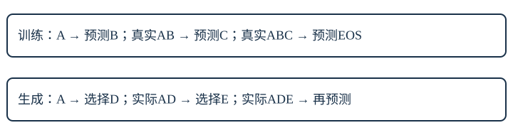

# 13｜下一token训练：标签错一位，任务就变了

本章把完整decoder连到训练目标与逐步生成。读完要能列出“这一行看见什么、应该预测什么、损失算给谁”，并解释为什么训练能并行而生成要一步步走。前置是[完整decoder](12-decoder.md)与[训练循环](07-training.md)。

## 1. 同一段文本，输入和目标错开一位

这节用四个符号建立正确索引，避免网络学成复制当前输入。

先用教学序列 `A B C EOS`，每个符号都是一个token。`EOS`读“序列结束”，是有自己ID的符号，不是屏幕上的几个英文字母。训练输入取 `[A,B,C]`，目标取 `[B,C,EOS]`：

| 输出位置 | 因果网络可见输入 | 目标 | 不该做什么 |
|---|---|---|---|
| 0 | A | B | 不以A作为自己的标签 |
| 1 | A B | C | 不允许读输入位置2的C |
| 2 | A B C | EOS | 不把结束符当成免费忽略项 |

数组里已经放着整段输入，不表示每个位置能读整段。模型给出三行logits，遮罩使第一行只依赖A，第二行只依赖A、B。目标数组进入损失函数，不作为该位置的输入线索。

把这条规则写为：`输入=s[:-1]，目标=s[1:]`。`s` 是一条完整token序列，`[:-1]` 表示去掉最后一项，`[1:]` 表示去掉第一项。若原序列长度4，就得到3对输入/目标。不要先把目标填成当前输入，再期待“下一token模型”这个名字自动改变任务。

实际实验采用字符级token，所以单词 `cat` 通常分成 `c/a/t`，不是一个预切英文单词。上表A/B/C只是核索引的小例；中文标签“服务”也不等于实际只有一个token。

## 2. 损失按哪些目标平均

这节手算三个预测的损失，确认平均分母不是输入字符总数的随意选择。

假设三行对各自正确目标的概率依次为 `0.5、0.25、0.8`。交叉熵对每行取正确目标概率的负自然对数：

```text
预测B：-ln(0.5)  ≈ 0.693147
预测C：-ln(0.25) ≈ 1.386294
预测EOS：-ln(0.8)≈ 0.223144
平均：(0.693147+1.386294+0.223144)/3 ≈ 0.767528
```

这里的 `ln` 读“自然对数”；平均损失常记为 `L`，是损失的英文首字母；`p_t` 是第t个目标token被模型分配的概率。一般就是 `L=所有有效目标的(-ln p_t)之和 / 有效目标个数`。当前例有效目标有3个，不是4个，不是词表大小，也不是句子数量。

若另一个小批有1个目标、损失2，合并平均应为 `(3×0.767528+1×2)/4≈1.075646`。直接把两批均值相加除以2会得到1.383764，给短批过大的权重。报告比较基线时，必须使用同一批目标与同一平均口径。

EOS在本实现是要预测的真实目标。未知字符映射到UNK，是词表覆盖问题；没有PAD，所以不要给本实现编造“自动忽略PAD”的行为。后面SFT会选择一部分目标计损失，那是另一种显式规则。

## 3. 真实前文与生成前文的分岔

这节解释teacher forcing与自回归生成的差异，明确误差从哪里累积。

训练时给定真序列A、B、C，预测C的那一行输入是**真实的B**；即使预测B的那一行最可能输出D，训练时也不立刻把B替换成D。这样提供真实前文的方式常叫 teacher forcing，读作“教师强制”，可以直接理解为“用数据里的真实前文继续训练”。

生成时没有未来真答案。若提示是A，模型分布为 `B:0.6,D:0.4`，贪心选择B；下一步用AB。若通过采样选了D，下一步就必须用AD，不能偷偷改回AB。生成中的某次选择改变后续条件，整段路径可能走向训练中很少见的前文。



因果遮罩让训练中的每一行都只看合法前缀，因此多行能在一次矩阵计算中完成；每个位置对应的真实输入预先已知。生成的下一次输入则依赖这次选中的token，所以通常必须等待这一步结束。并行训练不等于让第一行偷看第三行。

## 4. 生成策略与停止条件

这节用一个分布比较选择方式，知道“概率最高”与“整句正确”没有同义关系。

对 `[A:0.5,B:0.3,EOS:0.2]`，贪心选A；采样按这些概率抽一次，可能得到B或EOS。概率0.5不是“这个答案有50%事实正确”，只是该前缀下该token的分布数值。连续两次贪心也不保证整段序列概率最高：若先选A后最优延续概率0.2，路径为 `0.5×0.2=0.1`；先选B后最优延续概率0.8，路径为 `0.3×0.8=0.24`。

本课代码使用贪心 `argmax`，读“取最大值所在下标”，便于复现，不提供随机采样品质承诺。遇EOS停止，或者达到上下文/新增token预算停止；预算停止不能说成模型已经学会自然结束。没有滑动窗口：前缀超过64位置要显式处理，不悄悄丢掉开头。

## 5. 运行标签与生成检查

这节给出实际练习，把预测数组和停止原因都纳入检查。

```bash
python3 -m llm_course.experiments
python3 -m llm_course.train --dataset toy --steps 200 --out outputs/toy
```

第一条包含移位目标及回答区损失遮罩的小实验；第二条会真实训练并写 `outputs/toy/report.md` 和 `report.json`。先手写 `A B C EOS` 的两数组，再查代码如何从序列构造窗口。看报告的生成样本和停止原因，逐个区分“预测EOS结束”和“预算结束”。运行多久、损失多少由当次报告说明，本章没有预设结果。

故障练习：输入等于目标时，当前token的embedding就已经暴露标签。损失可能很快下降，却不是下一token任务。另一方面，即使移位正确，未加因果遮罩仍会让早期位置看到之后的正确答案。两项都要核对。

## 6. 换数小测

这节检验三类最容易发生的实现错误。

1. 对 `[Q,R,S,T,EOS]` 写输入、目标及有效目标数。
2. 两个目标概率分别0.2、0.5，平均交叉熵是多少？若下一批只有一个目标、损失0.3，合并平均是多少？
3. 训练文本为QRS，模型预测R时却选了X。预测S的训练输入用QR还是QX？真正生成下一步呢？

<details><summary>展开完整答案</summary><ol><li><p>输入[Q,R,S,T]，目标[R,S,T,EOS]，有效目标4个。预测EOS的最后一行也算目标。</p></li><li><p>两个损失约1.609438与0.693147，平均1.151293。合并三目标为(1.609438+0.693147+0.3)/3≈0.867528，不能对两个批均值直接平均。</p></li><li><p>teacher forcing训练用真实QR，预测S的损失不依赖上一行实际选中了什么。真正生成若选了X，后面输入是QX；只有显式更改生成过程才能换回QR。</p></li></ol></details>

下一章：[在CPU上真实训练一个微型decoder](14-toy-training.md)。
