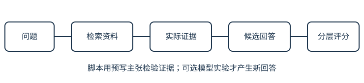

# 18｜有证据的问答：把“看起来不错”拆成可核对的判断

本章用三条固定资料完成一个很小的问答评价项目：先查有没有找到证据，再查输出是否受证据支持，最后说明当前实验还证明不了什么。前置是[自然语言实验](15-real-text.md)；不需要搭建RAG平台、购买模型API或相信小decoder已有问答能力。

## 1. 先固定资料和问题

这节把任务输入、参考依据与期待行为写清，避免生成后才修改评分标准。

下面三条是课程作者编写的教学制度，不是真实生产规范。项目只允许根据这些资料回答；资料没有的内容应说明缺失，不能靠常识补成制度。

| 资料ID | 完整内容 |
|---|---|
| timeout | 请求超时后最多重试2次；每次重试间隔1秒。 |
| backup | 系统每天凌晨2点备份，保留7天。 |
| deploy | 发布前必须通过自动测试，失败时回滚到上一个版本。 |

三个演示问题是“超时后重试几次？”、“备份保留几天？”和“测试失败如何发布？”。脚本分别给它们标注相关资料timeout、backup、deploy，并提供预写待核对主张。**这些主张是人工写入的测试输入，不是模型回答。**

任务可以拆成五个问题：输出要有资料支持的回答；输入是给定文本、不能访问隐藏制度；本实验没有训练；评价关心证据召回与支持关系；系统先用简单检索，不默认需要大模型。这样做可以发现瓶颈是否真的在语言生成。

## 2. 检索好不等于回答好

这节沿数据流定位错误，避免一个总分掩盖不同失败。



若问备份保留期却只取到timeout，首先是检索失败；若拿到backup仍回答“保留30天”，是回答偏离证据；若说“保留7天，因此每周必须删除全部备份”，前半有依据，后半新增了制度。引用了正确资料ID，也不能使额外主张自动正确。

当前检索器只是按中文字符集合重合数排序，取第一项，并以资料ID打破平局。它不理解同义词、不做复杂推理。“保留多久”和“保存期限”是否都能检索到，必须测；三个熟悉措辞上的正确结果不能推断任意问法都正确。

## 3. 手算两个指标

这节算清召回率与原文支持率的分母，并指出它们各自遗漏了什么。

`Recall@1`读“取前1项的召回率”。对某个问题，它等于“找到的相关资料数 / 全部相关资料数”。若有2条相关资料而只取回1条，得到 `1/2=0.5`；即使第一项完全相关，也没有找齐所有依据。当前三道题各只有1条标注相关资料，命中为1，未中为0。

平均以问题为单位算。独立示意：三题召回分别1、0.5、0，则平均 `(1+0.5+0)/3=0.5`。如果各题需要的资料条数不同，它不等于把所有相关资料混在一起算的总召回；要说明采用哪种口径。

第二个指标是 `exact_quote_supported`，含义是“非空主张是否为所引用资料中的连续原文”。例如“保留7天”在backup里，所以返回true；“无限重试”不在timeout里，返回false。若4条主张中3条通过，原文支持率 `3/4=75%`。

> 原文包含不是语义正确性的完整判定。资料“不得无限重试”包含“无限重试”四字，但抽出来主张“无限重试”就丢了否定。当前脚本没有语义蕴含检查，也不判断回答是否全面、是否正面回答问题。

改写成“保存一周”可能语义正确，却不能通过连续原文检测；反过来只答“保留”虽来自原文，也没回答几天。自动指标适合发现部分机械错误，最终答案质量仍需按固定标准逐主张检查。

## 4. 运行并保留真实输出

这节执行标准库脚本，明确这次实际运行了什么。

从课程根目录运行：

```bash
python3 labs/evaluation.py
```

这条命令不调用LLM，不产生任何模型回答。当前随课三题运行结果为：每题 `recall_at_1=1.0`、每条预写主张 `exact_quote_supported=true`，两个均值均为1.0；“无限重试”的反例支持判断为false。这只证明当前三个固定例子上的检索与原文检查结果，不是问答系统100%正确率。这三题参与过课程与脚本开发，也不是未触碰的独立测试。

可以用下面的标准shell重定向原样保存本次日志：

```bash
mkdir -p outputs/evaluation
python3 labs/evaluation.py > outputs/evaluation/retrieval.json
```

保留脚本版本、资料版本、执行时间与原始JSON。若输出与上述不同，先比较资料和代码版本，不手工改输出。原始日志与说明分开，解释可以修订，运行证据不能被润色成另一次结果。

## 5. 选修：接入你真正调用过的模型

这节给可执行的评价过程，不伪造一段“模型可能会回答”的文本。

没有模型也能完成前面的主线。若希望测已有模型，先固定一个简短提示：“只根据以下资料回答，列出资料ID；资料不足时说明不足。”对三题使用同一份资料与同一规则，记录实际调用。课程的小decoder不是指令助手，不要求它完成这个实验。

每题日志至少保存：问题、实际送入的完整资料、提示、模型名与确切版本、调用日期、温度/最大输出等设置、未经修改的原始回答、来源ID、耗时与错误。无法取得精确版本或成本时写“未提供”或“未测”，不要猜。只有真正执行并保存，才可以给模型填分；复制本章预写主张不能当作模型输出。

人工评分可采用四项：所需证据是否检索到；回答里的每个事实主张是否有支持；是否回答完整；无证据时是否承认缺失。费用与延迟独立记录。以同一问题同一资料比较方案，不能给一个模型完整资料、另一个只给标题，却把差别全归因于模型能力。

保留新问题的方法是：在调提示之前另写一批题并固定答案依据；开发只用演示题，候选确定后再打开保留题。若已经看过保留题错误再调提示，就标记复用，另增题目做后续验证。公开课程读者会看见题和答案，因此也不宣称它是长期秘密基准。

## 6. 用最小反例决定下一步

这节根据失败选择改动，而不是因为完成课程就开始搭复杂平台。

| 观察 | 下一项更有区分力的实验 |
|---|---|
| 同义问法找不到资料 | 比较字符检索、关键词表或向量检索，固定问题集 |
| 证据已给足但数字答错 | 检查提示与模型回答，逐主张对照原文 |
| 无答案问题仍编制度 | 加入缺失证据题，统计错误回答与恰当拒答 |
| 句子正确但引用错 | 单独标记引用定位错误 |
| 三题全过 | 增加新措辞、多证据、冲突或过期资料；不直接宣称上线 |

一个明确的缺失题是“备份是否异地保存？”：当前三条没有地点信息，不能由“每天备份”推出“异地备份”。这也是训练损失无法代替的工程验收：模型可以很擅长续写，同时在本任务里缺少依据。

## 7. 换数小测

这节用三个边界问题检查评价是否诚实。

1. 一题有3条相关资料，前2项找到其中2条，Recall@2是多少？能否说回答已有全部依据？
2. 资料写“不得跳过测试”，主张为“跳过测试”，当前原文包含检查可能怎样？该怎样补判？
3. 没有调用模型，只运行脚本得到两个1.0。可以写“模型问答正确率100%”吗？

<details><summary>展开完整答案</summary><ol><li><p>2/3≈0.6667。还有一条相关资料未找到，是否足以回答要看它包含什么，不能单由召回数字断言依据齐全。</p></li><li><p>连续子串检查可能返回true，因为这四字确实出现，但否定被丢失，主张方向与资料相反。需要在完整句子语境下判断是否支持，并把这种局限与失败例保存。</p></li><li><p>不能。脚本检验固定检索与预写主张的原文支持，没有模型生成。只能报告这三题的两个机械指标；真实模型正确率需要真实输出、判定标准与足够明确的测试范围。</p></li></ol></details>

回看[课程入口](../README.md)，用“能手算一步、能复现实验、能解释失败、能限定结论”检查自己下一步要补什么。材料读完与能力已经获得，应由实际练习分别判断。
