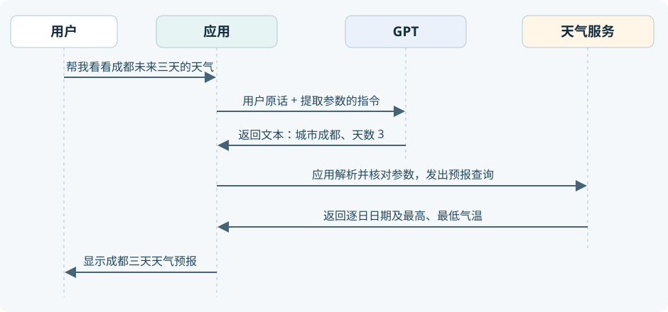
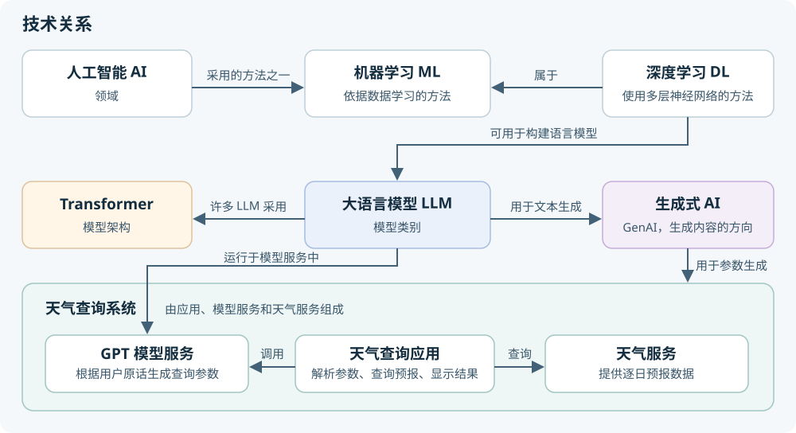

# K01-01 一次请求怎样走完整个系统

> 帮我看看成都未来三天的天气

假设你维护着一个天气应用。用户原来在下拉框里选城市，再选天数，点一下查询。现在要加一个输入框，让用户直接打上面这句话。查天气、排表格的代码都是现成的，缺的只有一步：**把这句话变成“成都”和“3”这两个值。**

这一步交给大语言模型（LLM）。本章跟着这句话把整个系统走一遍，看清三件事：模型交回的到底是什么，应用拿到以后做了什么，屏幕上的温度是谁给的。

<a id="trace"></a>

## 一句话怎样变成三天预报

**这节在干嘛**　先不碰终端，跟着这句话走完四步。看完你能指出哪一步调用了模型，哪一步调用了天气服务。

**① 应用把任务交给模型。** 应用收到用户原话，在前面加上一条指令：从这句话里提取城市和天数，用 JSON 文本交回。应用交出去的只有这条指令和用户原话，其中没有气温。

**② 模型交回一段文本。** 模型服务运行一个已经训练好的模型，根据收到的文字逐步生成输出。这一次，它实际交回的是这一行：

```json
{"city":"成都","days":3}
```

这个过程叫**推理**。模型从原话里认出了城市，把中文的“三天”写成了数字 `3`，写到右花括号就结束了。注意它交回的是**一段文本**。这段文本长得像 JSON，可在应用解析它之前，它和别的字符串没有区别。

**③ 应用去查天气。** 应用用 JSON 解析器从文本里取出两个值。它给“成都”配置了一个查询点（北纬 30.67°、东经 104.07°），把这个位置和 `forecast_days=3` 发给天气服务 Open-Meteo，要每天的最低和最高气温。这里有一个产品上的决定：“未来三天”从哪天算起？本例按成都当地日期，**从查询当天起连续三天**。这个口径是应用定的，模型没有参与。

**④ 应用把结果显示出来。** 天气服务交回日期和两组温度，应用把同一天的数排成一行。下面是按 **2026 年 11 月 18 日取得的预报**排出的结果：

| 成都当地日期 | 最低气温 | 最高气温 |
| --- | ---: | ---: |
| 11 月 18 日 | 9.3 °C | 14.9 °C |
| 11 月 19 日 | 6.0 °C | 15.0 °C |
| 11 月 20 日 | 5.8 °C | 16.8 °C |

用户只问了一句。为了回答它，应用先拿到 **1 份模型的回答**，又拿到 **1 份天气服务的响应**，最后的表格是程序排出来的。



把四步里三方各自经手的东西列出来：

| 谁 | 收到什么 | 交回什么 |
| --- | --- | --- |
| 模型服务 | 一条指令和用户原话 | 一段文本：`{"city":"成都","days":3}` |
| 天气服务 | 经纬度和天数 | 三天的日期、最低和最高气温 |
| 应用（你写的代码） | 用户原话，以及上面两方交回的东西 | 屏幕上的三行预报 |

模型没有查天气，它交回的文本里没有温度。天气服务没有读用户的话，它只认经纬度和天数。把两头接起来的是应用。如果把输入框去掉，让用户回到下拉框，第三、四步照样能工作。

<a id="inputs"></a>

## 回放一次，亲自核对每个数从哪里来

**这节在干嘛**　用随课保存的真实请求和响应，把刚才的四步在自己的终端里重走一遍。

按[课程导读的实验准备](../ABOUT.md#lab-setup)进入仓库根目录 `llm-for-software-engineers`，**建议亲手运行**：

```bash
python3 v2/01-request/lab.py
```

这条命令在本地**回放**两份历史记录：一份是当时模型的回答，一份是当时天气服务的响应。程序重新解析参数、读取逐日数据并展示。它不联网，不重新调用模型。无论你哪一天运行，显示的都是采集时那三天的预报。

随课的模型回答和天气响应是分别真实采集的：天气快照在前，模型回答在后。实验按匹配的查询参数把它们接起来，重建上面的调用流程；它们不是同一笔在线请求的完整日志。

<a id="request-parts"></a>

### 先看交给模型的话，再看它交回的原文

打开[请求文件](inputs/weather-request.json)和[模型调用记录](records/chengdu-gpt.json)，对着下表看。

| 应用交给模型的内容 | 这一次的实际文字 |
| --- | --- |
| 指令 | 从用户的天气问题提取查询参数。只返回一个 JSON 对象，city 是中文城市名，days 是整数天数。不要查询天气，不要给预报，不要使用工具或 Markdown。 |
| 用户原话 | 帮我看看成都未来三天的天气 |

这次采集通过 Codex 命令行请求 `gpt-6.1-sol`，推理档位是 `medium`。记录里的 `capture.stdin` 是实际交出去的完整文字，`response.text` 是模型交回的原文。

**在终端的输出里找两个值。** 先找模型交回的原文，再看“应用解析出的查询参数”下面那一行里的 `"days": 3`。原文是一串字符；经过 `json.loads`，程序才拿到整数 `3`，可以像普通的请求参数那样使用。再找第一天的最高气温 `14.9`。模型的回答里只有城市和天数，这个数不在里面；要找到它的来历，得看下一份记录。想逐个字段看，给命令加上 `--json`，解析出的天数在 `parameters.days`。

> 看不懂可以跳过，记住结论就行。这份记录保存的是课程交出去的文字和模型交回的文字。命令行工具自己附加的内容、底层的网络报文、服务端实际运行的模型版本，都不在记录里，所以记录中“服务端回报的模型”一栏写的是未知。

<a id="observed"></a>

### 再看天气服务的响应，手工还原一行

打开[天气服务的原始响应](records/chengdu-forecast.json)。`url` 里有坐标和天数，`body.daily` 里有三个按天对齐的数组，`body.daily_units` 写明温度的单位。

| 从 `body.daily` 读取 | 第 1 项 | 第 2 项 | 第 3 项 |
| --- | --- | --- | --- |
| `time` | 2026-11-18 | 2026-11-19 | 2026-11-20 |
| `temperature_2m_min` | 9.3 | 6.0 | 5.8 |
| `temperature_2m_max` | 14.9 | 15.0 | 16.8 |

沿第 2 项往下读：日期是 11 月 19 日，最低 6.0 °C，最高 15.0 °C。这就是屏幕上的第二行。如果还想显示这一天的温差，程序算 `15.0 − 6.0 = 9.0 °C` 就行，不必再问模型。屏幕上每个数都有可以回查的出处。[天气接口字段说明](https://open-meteo.com/en/docs)

**预报不等于实况。** 这份快照能证明的是：采集的那一刻，天气服务给出了这些预测值。11 月 19 日那天实际多少度，要另查气象观测；现在重新查预报，也可能得到更新过的数字。

<a id="checks"></a>

## 应用凭什么相信这段文本

**这节在干嘛**　用写接口的经验回看这次调用。普通接口的响应有固定的字段；模型是按指令**生成**了一段文本。应用要先能读它，再判断读出来的值合不合适。

| 应用做的判断 | 在这个例子里怎样做 | 这个判断说明了什么 |
| --- | --- | --- |
| 能不能当参数读 | 解析 JSON，读出字符串 `city` 和整数 `days` | 文本符合约定的形式 |
| 参数是不是用户要的 | 把“成都”“三天”与原话对照 | 在这一句已知的输入上，模型提取对了 |
| 数据是不是对应这次查询 | 核对查询点、时区、天数、日期和温度单位 | 屏幕上的三行来自这一次天气查询 |

第一项和第二项是两回事。解析成功，只说明文本的形式对；值对不对，要拿原话来比。在本章的实验里，第二项靠的是我们事先知道答案：用户说的就是成都、三天。

换一句话试试。用户把“三天”改成“两天”，你可以在调用之前就预测：城市不变，天数应当变成 2。这是一条新的测试输入，刚才的记录只验证了“三天”这一句。

再换一句：“那里明天天气怎么样？”应用没有提供前文，城市从哪里来？合理的做法是先问清地点。可是按现在的约定，模型只能交回城市和天数，连“我需要先问一句”都没有地方写。[第 02 章](../02-contract/lesson.md)从这里开始。

<a id="technology-map"></a>

## 这次调用的那个“模型”是什么

**这节在干嘛**　给刚才用到的几个词排个位置，建立一张大图。细节后面各章会讲，这里只要知道它们之间的关系。



从图的下半部分看起：天气查询系统由三部分组成，其中模型服务负责运行 GPT。往上看，GPT 属于**大语言模型**。大语言模型是机器学习模型的一类，许多大语言模型采用一种叫 Transformer 的架构。它的能力来自训练：训练得到一大批数值，叫**参数**，推理时用这些参数做计算。输入是一段文字，生成的也是一段文字；这段文字可以给人读，也可以像本例这样交给程序解析。

有三点现在就可以记住：

- 模型是**事先训练好**的。这次调用没有改变它，只是用了它。
- 模型的参数**不会随外部世界自动更新**。成都这三天的预报，是应用另外从天气服务取来的。
- 模型服务和你的应用是**两个系统**。你能看到的，是交出去的文字和交回来的文字。

还有一点要留意：这次调用的记录，能让你检查交出去和交回来的文字。模型是用什么数据、按什么目标训练出来的，记录里看不到，要另找依据。

“参数参与计算”到底是什么意思，第 05 章会用一个能把所有参数读出来的小模型讲清楚。

<a id="quiz"></a>

## 四道小测：不用终端也能讲清这条链路

先合上记录，想想每一步手里已经有什么，还差什么。

<details><summary>1. 模型的回答到右花括号就结束了。如果这时断网，应用手里有什么，还缺什么？假设还没有查天气，也没有缓存。</summary><p>应用有一段能解析出成都和 3 的文本，还缺天气服务交回的日期和温度。只凭模型的回答，显示不出真实的预报。</p></details>

<details><summary>2. 用户只点了一次查询，为什么有两份响应记录？回放一次会发出几个新的网络请求？</summary><p>一次查询要经过两步：模型交回查询参数，天气服务按这样的参数交回预报，所以有两份记录。随课的两份是分别采集的，回放时按相同的参数接起来。回放从磁盘读取它们，新的网络请求是 0 个。</p></details>

<details><summary>3. 第二天的温差是多少？算它需要再调用一次模型吗？</summary><p>日期数组的第二项是 11 月 19 日，同一位置的最高气温是 15.0 °C，最低气温是 6.0 °C，程序相减得到 9.0 °C。不需要再调用模型：一次调用已经完成了参数提取，剩下的是程序的计算。</p></details>

<details><summary>4. 如果模型交回的是成都和 7 天，而且 JSON 完全合法，能说它读懂了用户的话吗？</summary><p>不能。解析成功只说明文本的形式对。用户说的是三天，天数应当是 3，这一项要对照原话才能判断。下面的选做实验可以看到这个区别。</p></details>

<a id="faults"></a>

## 选做排错：同一条回答在哪一步出问题

已经能复述整条链路，就可以进入下一章。想练习定位问题，再做这一节。下面两条命令各自改动一份回答的副本，原始记录不受影响。先预测是“读不出对象”还是“读出了对象但天数不对”，再对照终端的结果。

```bash
python3 v2/01-request/lab.py --fault invalid-json
python3 v2/01-request/lab.py --fault wrong-days
```

第一条故意破坏 JSON 文本，应用在解析这一步就发现了错误。第二条保留正确的字段类型，只把天数改掉；这次解析能成功，按“三天”一核对就失败了。两条命令都应当返回非零的退出码。最后再运行一次普通回放，用原始的回答重新得到三天的预报。

<a id="desktop-chat"></a>

## 换到 ChatGPT 桌面端，同一句话怎样变成回答

你也可能根本不写代码：打开电脑上的 ChatGPT，输入同一句话，按下发送。这时 **ChatGPT 就是那个应用**。接收对话、调用模型、在需要时去找最新的信息、把回答显示出来，这些事由产品替你做了。

| 同一个天气问题 | 你自己开发天气应用 | 你直接使用 ChatGPT 桌面端 |
| --- | --- | --- |
| 谁决定模型要做什么 | 你在代码里写明“提取城市和天数”，程序等着接这两个字段 | 你只提出最终的目标“看天气”，怎样拆成步骤由产品决定 |
| 预报从哪里来 | 你的应用按参数调用 Open-Meteo | ChatGPT 可以在需要最新信息时联网搜索；回答附了来源时，可以点开核对地点、日期和温度 |
| 你能看到什么 | 交给模型的文字、模型交回的文字、天气服务的响应 | 你发出的消息、屏幕上的回答、界面显示的搜索活动和引用 |

两种用法里，模型做的是同一类事：根据收到的文字生成文字。差别在**谁负责把模型和外部信息接起来**，以及你能看到多少中间过程。在本章的回放里，你能指出哪一段是模型交回的中间结果，也能打开随后的天气响应。在桌面端，来源链接能帮你核对温度；中间有没有生成过一段类似的参数、模型被调用了几次，要有产品内部的调用记录才能确认。[OpenAI 官方说明：ChatGPT 怎样搜索和引用来源](https://help.openai.com/en/articles/9237897-searching-the-web-with-chatgpt)

<a id="next"></a>

## 约定不够用的时候

本章的应用只认识一种回答：城市和天数。用户说“那里明天天气怎么样？”，它连“我需要先问一句”都没有地方写。[第 02 章](../02-contract/lesson.md)把约定补到能处理这样的话。
