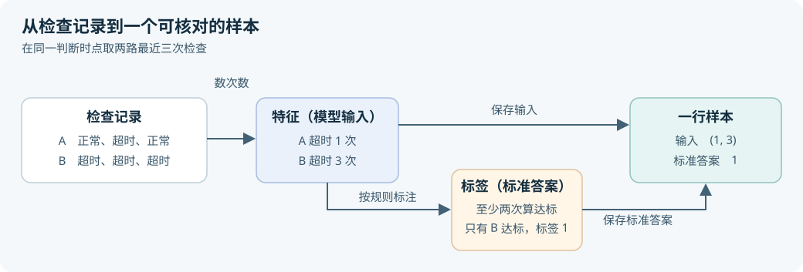
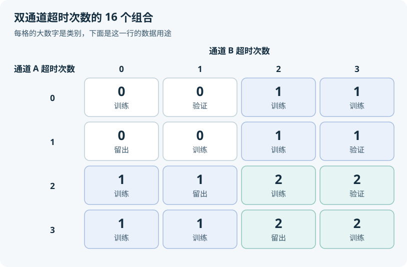
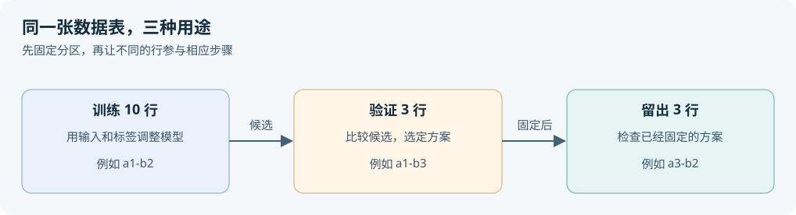

# K01-04 从例子里学

前三章用的是别人训练好的模型。你走通了一次调用，写清了什么算对，做出了第一份评测，能判断应用在一组输入上做得对不对。

上一章结尾留下一个调用记录回答不了的问题：模型是怎样从“上海接下来两天”得到 `2` 的？要回答它，得打开模型，弄清三件事：里面有什么，怎样从输入算到输出，里面的东西是怎么来的。

这一章从第三件事开始：**模型是怎样被样本教会的。** 先把整个过程从头到尾看一遍，不追究细节；再认识这个过程用的数据。计算的细节留给后面六章。

<a id="why-switch"></a>

## 为什么换一个例子

**这节在干嘛**　交代从这一章起为什么不再用天气查询，哪些认识带得过来，哪些结论带不过去。

天气任务能让你看到应用做得对不对，却看不到模型里面怎么算：那个模型的参数多到无法跟着算一遍。所以接下来七章换一个小任务，小到每一步都能用纸笔算出来：两个数进去，三个候选里选一个，全部数据只有 16 行。

**带得过来的**是前三章的做法：先规定什么算对，再用样本检查结果。那十条天气题是写指令时一直看着的题，只用于演示、开发和回归。这一章把这个区分做得更细：哪些数据参与调整模型，哪些用来在几个方案里选一个，哪些留到方案固定之后才用来检查。

**带不过去的**是结论。这个小任务上得到的任何结果，都不说明大语言模型的能力。它只用来看清机制。

还要先说明一点：**这道小题用一行规则就能完全做对。** 真要解决它，写规则就行了，用不着模型。让模型从样本里学，是为了观察学习的过程：每一种输入的正确答案我们都知道，所以模型学到了什么、哪里没学到，都能核对。

<a id="task"></a>

## 一道小题：输入、标签、标注规则

**这节在干嘛**　认识这道小题，以及描述一份数据要用的三个词。

一个服务有 A、B 两条通道。每条通道最近做过三次检查，记下其中超时了几次。于是每条通道有一个 0 到 3 之间的数，记作 a 和 b。要判断的是：**有几条通道的超时达到了 2 次。** 答案是 0、1 或 2。



图里出现了三样东西，后面每一章都要用：

- **输入**：交给模型的数。这里是两个计数 a 和 b。输入里的每一项也叫**特征**。
- **标签**：这一行输入的正确答案。这里是 0、1、2 当中的一个，也叫**类别**。
- **标注规则**：标签是怎样定出来的。这里是：超时达到 2 次的通道有几条，标签就是几。

一行输入配上它的标签，叫一条**样本**。

还要留意输入里**没有**什么。三次检查的记录被数成了一个次数，哪一次超时、先后顺序如何，都没有留下。只凭 a 和 b，回答不了“最近一次检查有没有超时”这样的问题。输入里没有的信息，模型无从利用；拿什么当输入，是人在模型之前作出的决定。

先自己做四行。按标注规则，下面四行的标签各是多少？

| a | b | 标签 |
| ---: | ---: | --- |
| 1 | 3 | ？ |
| 2 | 2 | ？ |
| 1 | 1 | ？ |
| 3 | 0 | ？ |

<details><summary>答案</summary><p>依次是 1、2、0、1。第一行只有 B 达到 2 次；第二行两条都达到；第三行两条都没达到；第四行只有 A 达到。</p></details>

a 和 b 各有 4 种取值，输入一共只有 16 种，全部列在下面这张图里。每格的大数字是标签，下面的小字是这一行的用途，下一节解释。



按[课程导读的实验准备](../ABOUT.md#lab-setup)进入仓库根目录，让程序把 16 行逐行核对一遍：

```bash
python3 v2/04-task/lab.py
```

程序对每一行用规则重算标签，与数据文件里保存的标签对照，再检查 16 种输入是否各出现一次。这次的结果是“核对通过”。想看核对能不能发现错误，可以让它在内存里故意改错一个标签：

```bash
python3 v2/04-task/lab.py --fault wrong-label
```

这道题和天气任务有一个根本的差别。这里的标注规则写得出来，一行代码就够：

```python
def label_for(a, b):
    return int(a >= 2) + int(b >= 2)
```

天气任务不是这样。“上海接下来两天冷不冷”该提取成上海、2 天，“那里明天天气怎么样”该先问是哪里，这样的判断写不成几行规则。**可靠的规则写不出来，或者写出来也难以维护，手里又有足够的例子和判断对错的依据，这时才值得考虑让模型从例子里学。** 这一章反过来选了一道规则已知的题，为的是每一步都有标准答案可对。

<a id="overview"></a>

## 看一遍完整的学习过程

**这节在干嘛**　在讲任何计算之前，先把“从样本里学”的全过程看一遍，知道后面六章各自在讲哪一段。

课程事先用这 16 行数据训练过一个小模型，留下了一份记录。下面的命令只回放这份记录，不重新训练：

```bash
python3 v2/04-task/lab.py --preview
```

输出分四步。里面有些词现在还没有讲，先照着字面读。

**① 用训练的 10 行调整模型。** 模型里有一批可以调的数。它们一开始是随便取的，这时让模型判断训练的 10 行，只答对 2 行。然后重复同一个动作：让模型算出这 10 行的结果，与标签比较，把那批数各改一点，让结果离标签近一些。记录里重复到第 200 次时，10 行已经全部答对。

**② 用验证的 3 行选方案。** 该重复多少次才停？这件事调整过程自己回答不了。办法是在途中留下若干份“当时的那批数”，每一份算一个候选方案，再拿另外 3 行来比较它们。这 3 行没有参与调整。记录里一共留了 12 份。比较用的指标叫验证损失，它衡量预测与标签差多少，越小越好，算法到第 08 章再讲：

```text
   调整次数  训练答对  验证损失
          0     2/10    1.3038
          …
        200    10/10    0.5773
        500    10/10    0.3597  ← 验证损失最小，选这一份
       1000    10/10    0.3728
       2000    10/10    0.4128
```

**③ 固定方案。** 选定第 500 次调整之后的那一份，从此不再改。

**④ 对没见过的输入预测并检查。** 还有 3 行数据到这时才第一次使用。固定下来的模型在这 3 行上全部答对。

把四步连起来，就是“学”这个词在本课里的意思：**用样本反复调整模型里的数，再用没参与调整的样本检查结果。**

读这份记录时有三点要留意：

- **它是一次运行的记录。** 选定的方案在验证的 3 行上答对 2 行，在留出的 3 行上答对 3 行。3 行太少，错一行就差 33 个百分点。换一个起点重新训练，结果会不一样。第 10 章会回到这份记录仔细看。
- **人和程序各做了一部分。** 准备数据和标签、决定模型的结构、决定留哪些候选、按什么指标选，是人定的。调整那批数，是程序按固定的办法做的。
- **第 01 章调用的大语言模型，也是用样本一步一步调出来的。** 数据、可调的数和计算量都大了很多个数量级，训练的目标也不同，第 16 章再讲。

四步里留下的问题，正是后面几章的内容：

| 留下的问题 | 在哪一章 |
| --- | --- |
| “可以调的数”是什么，模型怎样用它们从输入算到输出 | 第 05、06、07 章 |
| “离标签近一些”怎样用一个数来衡量 | 第 08 章 |
| 每个数该往哪边改、改多少 | 第 09 章 |
| 这份记录该怎样读，学得到底怎样 | 第 10 章 |

<a id="splits"></a>

## 16 行数据的三种用途

**这节在干嘛**　分清刚才出现的三组数据各自做什么用，以及为什么不能混。

| 组 | 行数 | 用途 | 模型调整时用到了吗 |
| --- | ---: | --- | --- |
| 训练 | 10 | 参与调整模型里的数 | 用到 |
| 验证 | 3 | 在几个候选方案里选一个 | 没有，但选方案时看了它的结果 |
| 留出 | 3 | 方案固定以后，检查它在没见过的输入上做得怎样 | 没有，选方案时也没看 |



这样分有三条规矩：

1. **先分好，再训练。** 哪一行归哪一组，在训练之前就写进了数据文件，不是看了结果再挑。
2. **三组不重叠。** 同一行只能属于一组。
3. **留出的那一组最后才用。** 方案固定之前不看它的结果。

为什么训练的 10 行不能用来判断学得怎样？因为模型就是照着它们调的。在这 10 行上全对，可能只是把这 10 行记住了。要知道它对新输入做得怎样，只能看没参与调整的行。

为什么验证和留出还要分开？因为“选第 500 次的那一份”这个决定，是看着验证的结果作出的。被选中的方案在验证数据上的表现因此偏乐观：它正是因为在这 3 行上表现最好才被选中的。要得到一个没被任何决定用过的检查，就需要第三组。

第三条规矩最容易在不知不觉中打破。看了留出的结果，觉得不满意，回去改了设置重新训练，再看留出的结果：到这时，留出的 3 行已经参与了选择，它变成了验证数据。想再做一次干净的检查，得另找没用过的数据。

回头看前三章。十条天气题是写指令时一直看着的。从用途上说，它们相当于这里的训练和验证数据：参与了开发，所以它们的 10/10 不说明应用在新说法上的表现。相似的只是用途，那十条题并没有用来更新模型的参数。第 21 章会引入没有参与过任何调整的新题，那才相当于这里的留出数据。

上一节运行默认命令时，输出的末尾列出了三组的行数，以及每组里标签 0、1、2 各有几行：训练是 2、6、2，验证和留出都是 1、1、1。对着图核对一遍：三组加起来是不是正好 16 行，有没有哪一行出现了两次。

<a id="leak"></a>

## 反例：答案进了输入

**这节在干嘛**　看一种分了三组也防不住的错误。

假设数据里除了 a 和 b，还多了一列“处理级别”。它是事后填的：问题最后按哪个级别处理，就填几。而处理级别恰好是按“有几条通道超时达到 2 次”定的，所以这一列和标签一模一样。

```bash
python3 v2/04-task/lab.py --leak
```

程序构造了一个只会照抄第三列的“模型”。它是手写的一行规则，不是训练出来的，用来说明问题已经够了：

```text
一个只照抄第三列的“模型”（手写的一行规则，不是训练出来的）：
  训练 10/10，验证 3/3，留出 3/3
真正使用时，要判断的那一刻还没有“处理级别”。本实验假设这一列缺失时填 0：
  同样的 16 种输入，答对 4/16
```

三组数据全对，留出的 3 行也全对。可它什么都没学会。真正要判断的那一刻，“处理级别”还不存在。实验里假设这一列缺失时填 0，这个模型就一律回答 0。

这种情况叫**数据泄漏**：模型在训练或检查时，接触到了真正使用时拿不到、又和答案有关的信息。留出数据在这里起不了作用，因为留出的行里同样带着这一列。

泄漏还有一种更直接的形式：同一行既在训练里，又在验证或留出里。那样“没见过”就不成立了。核对程序能发现这种重叠：

```bash
python3 v2/04-task/lab.py --fault overlap
```

这条命令在内存里把训练组的一行原样放进了验证组，输入和标签都照搬。核对报告了三件事：同一个编号出现在两组里；同一种输入出现了两次；验证组原来的那一种输入不见了。

防泄漏靠的是对每一项输入多问两句：

- 真正要判断的那一刻，这个数拿得到吗？
- 它是不是从答案算出来的，或者是知道答案以后才填的？

要把泄漏和前三章的情况分开。那十条题参与过指令的开发，所以不能再用它们估计应用在新说法上的表现；这是数据用途的限制，属于正常的开发，不算泄漏。泄漏更进一步：真正使用时拿不到的信息进了输入，连留出的检查也跟着失效。

<a id="scope"></a>

## 这个小任务能说明什么

**这节在干嘛**　给后面六章要得出的结果先划好范围。

能说明的：

- 学习过程的每一步是怎样算的。任务小，每个数都能跟着算，也都能核对。
- 数据的三种用途为什么要分开，泄漏为什么会让检查失效。

不能说明的：

- **大语言模型的能力。** 这里的模型只有几十个可调的数，任务只有 16 种输入。
- **真实任务上的准确率。** 留出只有 3 行。
- **真实数据的难处。** 真实任务的输入列不完，标签可能有错，规则往往没人说得清。这里三样都没有。

<a id="quiz"></a>

## 四道小测：数据的用途

<details><summary>1. 按标注规则，a=3、b=2 和 a=0、b=1 的标签各是多少？</summary><p>2 和 0。第一行两条通道都达到 2 次；第二行两条都没有达到。</p></details>

<details><summary>2. 模型在训练的 10 行上全部答对。能据此说它学会了这道题吗？</summary><p>不能。模型就是照着这 10 行调的，全对可能只是记住了它们。要看它在没参与调整的行上做得怎样。即使那几行也对了，3 行也太少，只能说在这几行上没有出错。</p></details>

<details><summary>3. 你看了留出 3 行的结果，不满意，回去改了训练次数重新训练，再看留出 3 行。第二次的结果还能当作“没见过的数据上的表现”吗？</summary><p>不能。第二次的方案是参考了留出的结果才定下来的，这 3 行已经参与了选择，成了验证数据。要再做一次干净的检查，得用没被任何决定用过的数据。</p></details>

<details><summary>4. 一份数据的输入里有一列“是否已升级处理”，模型在留出数据上全对。你会先检查什么？</summary><p>先查这一列是什么时候、根据什么填的。如果它是知道结果以后才填的，或者能从答案推出来，就是答案进了输入。留出数据里也带着这一列，所以留出全对并不能排除这个问题。还要问：真正使用时，判断的那一刻拿得到这一列吗。</p></details>

<a id="next"></a>

## 把答案盖住，模型怎样打分

这一章看了学习的全过程，认识了数据。可“模型里那批可以调的数”还是一个黑箱：只给它 a 和 b，把标签盖住，它是怎样在三个类别里选出一个的？

[第 05 章](../05-models/lesson.md)打开这个黑箱：读出这批数，用它们亲手算一次。
