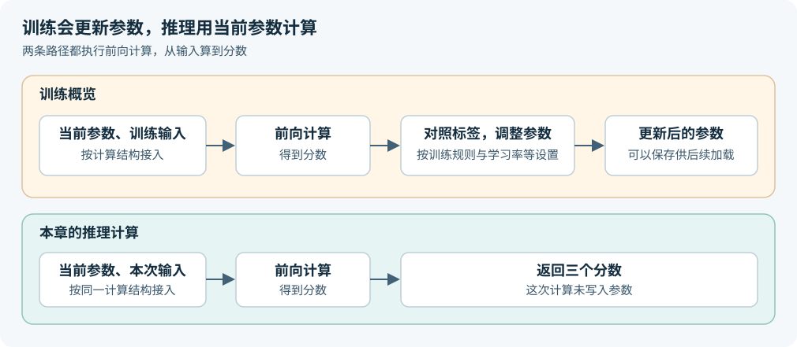
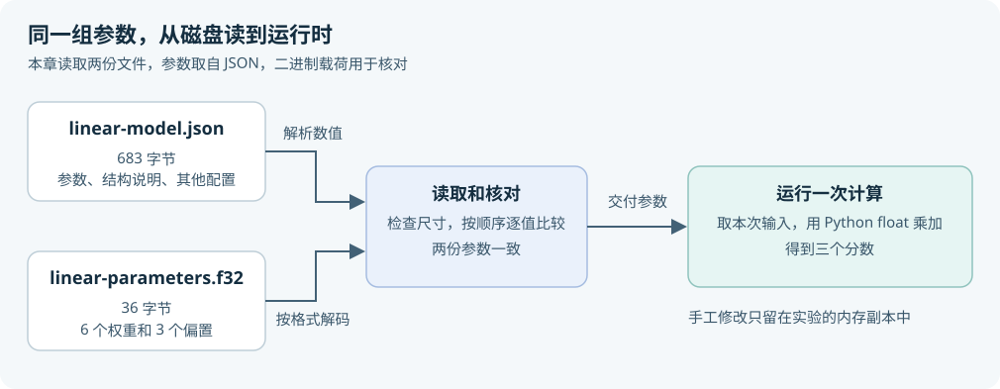

# K01-05 模型就是参数加一套算法

上一章看了一遍完整的学习过程，里面反复出现“模型里那批可以调的数”。这一章把它们拿出来看：一共几个，各是多少，怎样用它们从输入算到输出。

这一章用的是这道小题上最简单的一种模型，只做乘法和加法。它的九个数是**手工设定**的，没有经过训练，判断得准不准不是这一章关心的事。这一章只要求你能照着算，并且分清三种容易混在一起的改动：改输入，改参数，改外部数据。

<a id="parameters"></a>

## 九个数和一套算法

**这节在干嘛**　认识模型的两个组成部分：一批数，和使用这批数的固定算法。

上一章的小题：输入是两条通道的超时次数 a 和 b，要在类别 0、1、2 里选一个。

这个模型的做法是给三个类别各算一个**分数**，谁的分数高就选谁。每个分数都用同一个算式：

    某个类别的分数 = a × 这个类别给 a 的权重 + b × 这个类别给 b 的权重 + 这个类别的偏置

三个类别各有两个权重、一个偏置，一共九个数：

| | 类别 0 | 类别 1 | 类别 2 |
| --- | ---: | ---: | ---: |
| a 的权重 | 0.5 | 1 | 0 |
| b 的权重 | −1 | 0 | 2 |
| 偏置 | 0 | 0.5 | −1 |

- **权重**是和输入相乘的数。它决定某一项输入对某个类别的分数有多大影响，朝哪个方向影响。类别 2 给 b 的权重是 2：b 每多 1，类别 2 的分数就多 2。
- **偏置**是直接加上去的数，与输入无关。
- 权重和偏置合起来叫**参数**。上一章说的“可以调的数”就是它们。

除了这九个数，模型还有另一部分：先乘后加，算出三个分数，取最大的。这部分是程序，叫模型的**结构**或算法。在本课的训练里，结构固定不动，更新的只是参数。

**模型 = 参数 + 一套使用参数的算法。** 第 01 章调用的大语言模型也是这两部分，只是参数多得多，算法也复杂得多。

<a id="forward"></a>

## 手算一行

**这节在干嘛**　用九个参数把一行输入算成三个分数，再得到类别。

取 a=2、b=1。逐个类别套算式：

| 类别 | 算式 | 分数 |
| --- | --- | ---: |
| 0 | 2×0.5 + 1×(−1) + 0 | 0 |
| 1 | 2×1 + 1×0 + 0.5 | 2.5 |
| 2 | 2×0 + 1×2 − 1 | 1 |

三个分数是 0、2.5、1，最大的是类别 1，模型就选类别 1。按标注规则，a=2、b=1 只有 A 达到 2 次，标签也是 1。这一行选对了。

让程序算同一行，对一下：

```bash
python3 v2/05-models/lab.py
```

从输入算到输出的这一趟，叫**前向计算**。写成代码只有几行：

```python
def forward(x, W, bias):
    """x 是一行输入 [a, b]；W 有 2 行 3 列；bias 是三个偏置。返回三个分数。"""
    return [x[0] * W[0][k] + x[1] * W[1][k] + bias[k] for k in range(3)]


def choose(scores):
    """取分数最大的类别；并列时取编号较小的。"""
    return max(range(3), key=lambda k: (scores[k], -k))
```

三点说明：

- 分数只用来比大小。0、2.5、1 这三个数本身没有单位，也还不是概率。把分数变成概率是第 08 章的事。
- 两个类别分数相同时，本课约定取编号较小的那个。这是人定的规矩，为的是让结果确定。
- 输入里已经有一个 b，所以偏置在代码和命令里写作 `bias`。

再手算一行：a=0、b=0。

<details><summary>答案</summary><p>三个分数是 0、0.5、−1，最大的是类别 1。按标注规则这一行的标签是 0，模型选错了。输入全是 0 的时候，乘出来的都是 0，分数就等于偏置；类别 1 的偏置最大，所以选了类别 1。这组参数是随手设的，下一章会看到它在 16 行里只选对 7 行。</p></details>

<a id="changes"></a>

## 改输入，改参数

**这节在干嘛**　同样是“结果变了”，原因可以完全不同。先在小模型上把两种原因分开。

**只改输入。** 参数不动，把 a 从 2 换成 3：

```bash
python3 v2/05-models/lab.py --a 3
```

三个分数变成 0.5、3.5、1。九个参数一个都没变，变的只是这一次送进去的数。每一次使用模型都是这种情况：同一批参数，不同的输入。

**只改参数。** 输入还是 a=2、b=1，把“a 通向类别 0”的权重从 0.5 改成 1：

```bash
python3 v2/05-models/lab.py --set "W[a,0]=1"
```

三个分数变成 1、2.5、1。输入没变，结果变了：这时变的是模型本身。改动只发生在这一次运行的内存里，参数文件没有动。

先预测，再运行：输入还是 a=2、b=1，把类别 2 的偏置从 −1 改成 2，模型会选哪一类？

```bash
python3 v2/05-models/lab.py --set "bias[2]=2"
```

<details><summary>答案</summary><p>偏置直接加在分数上，类别 2 的分数从 1 变成 4，另外两个分数不变，是 0 和 2.5。最大的成了类别 2，模型改选类别 2。这一行的标签是 1，所以这一改把原来选对的改错了。</p></details>

上一章说训练就是“把那批数各改一点”。现在可以说得更准确：**训练改变参数；使用模型时参数不变，只是拿它们做前向计算。** 使用训练好的模型做计算，也叫**推理**。



<a id="external"></a>

## 回到天气应用：预报更新了，变的是哪里

**这节在干嘛**　认识第三种改动。它既不在输入里，也不在参数里。

回想第 01 章的调用链：用户说“帮我看看成都未来三天的天气”，模型交回城市和天数，应用拿着它们去查天气服务，把预报展示出来。

明天再问同一句话，屏幕上的气温变了。变的是哪里？

- 不是模型的参数。模型还是那一个。
- 不是模型的输入。用户的话和给模型的指令都没有变。这里假设模型交回的仍是成都、3 天。
- 是天气服务里的预报。它是应用从外部取来的数据。

这是第三种改动：**改外部数据**。

| 改的是什么 | 在这道小题里 | 在天气应用里 | 模型的参数变了吗 |
| --- | --- | --- | --- |
| 输入 | a、b 换成另一行 | 用户换了一句话；应用改了给模型的指令 | 没有 |
| 参数 | 九个数里改了一个 | 模型服务换了一个模型版本 | 变了 |
| 外部数据 | 这道小题没有 | 天气服务的预报更新了 | 没有 |

这三种改动是为了对照挑出来的，不是应用里一切变化的完整分类。例如改程序的规则，改的是应用自己的行为，三种都不算。

这张表对工程师有两个直接的用处。

**结果不对时，先问变的是哪一样。** 第 02 章把约定从两个字段扩成三种结果：改给模型的指令，是改输入；改程序的规则，改的是应用自己的行为。这次修改没有训练模型。第 03 章比较的两版应用，请求的模型名称和推理档位相同；服务端实际运行的是不是同一组参数，记录里没有独立的确认。

**需要随时更新的资料，不靠参数。** 参数是训练时定下来的一大批数，不会随外部世界自动更新。它通常也不像业务数据库那样，提供按一条记录去定位、可靠地读改删的接口。所以今天的预报由应用去取。新的资料可以放进这一次的输入，或者由外部工具提供；怎样把资料交给模型，是第 18 章的内容。

<a id="storage"></a>

## 参数占多少地方，读的时候要知道什么

**这节在干嘛**　参数最终是存在文件里的一串数。算一下它占多少地方，再看只有这串数为什么还不够。

```bash
python3 v2/05-models/lab.py --storage
```

九个参数，每个按 4 字节的单精度浮点数保存，一共 36 字节。算法很简单：

    权重文件的大小 ≈ 参数个数 × 每个参数占的字节数

同一个算式用到大模型上：假设一个模型有 70 亿个参数，每个参数用 2 字节保存，权重文件大约是 140 亿字节，也就是 14 GB 左右。模型文件大，主要就是因为参数多。这个数只是存在磁盘上的大小；运行时还要另外占内存，放计算过程中的中间结果，第 14 章再算。

再看文件里有什么。36 字节依次是这九个数：

    0.5, 1, 0, −1, 0, 2, 0, 0.5, −1

文件里只有数，没有写哪个数是哪个参数。本课的约定是：先存 2 行 3 列的权重，一行一行地存，再存 3 个偏置。按这个约定读出来，才是前面那张表。

如果约定弄错了呢？程序用同样的 36 字节，按三种约定各读一次，各算一次 a=2、b=1：

| 怎样读 | 读出的权重 | 读出的偏置 | 三个分数 | 选 |
| --- | --- | --- | --- | --- |
| 约定的读法 | [0.5, 1, 0]、[−1, 0, 2] | [0, 0.5, −1] | 0、2.5、1 | 类别 1 |
| 把前 6 个数当成一列一列存的权重 | [0.5, 0, 0]、[1, −1, 2] | [0, 0.5, −1] | 2、−0.5、1 | 类别 0 |
| 以为偏置存在最前面 | [−1, 0, 2]、[0, 0.5, −1] | [0.5, 1, 0] | −1.5、1.5、3 | 类别 2 |

三种读法都不会报错。读错了，得到的是另一个模型，照样能算出三个分数。

所以**使用一份参数，除了这串数，还必须知道结构的约定**：有哪几组参数，各自是什么形状，按什么顺序存，每个数是什么类型。实际的模型文件会把这些说明和参数存在一起，或者由配套的代码约定。



本章的实验读取参数时做了一次核对：参数同时以 JSON 文本和 36 字节的二进制两种形式随课保存，程序确认两份逐个相等才往下算。

<a id="optional"></a>

## 选读：字节序和参数指纹

这一节可以跳过，后面的章不依赖它。

```bash
python3 v2/05-models/lab.py --fingerprint
```

**字节序。** 第一个参数 0.5 在文件里是 `00 00 00 3f` 这 4 个字节。本课约定低位字节在前，叫小端。按相反的顺序读，同样 4 个字节得到的是 8.83e-44 这样的数，九个数全都面目全非，程序同样不会报错。字节序也是结构约定的一部分。

**参数指纹。** 对存盘的 36 字节算一个 SHA-256 摘要，就得到这组参数的指纹。九个数里只要有一个变了，指纹就不同。实验里把一个权重从 0.5 改成 1，指纹从 `c3e79a12…` 变成了 `47cfa76b…`。指纹的用处是确认“用的是不是同一组参数”：两台机器加载的是否一致，一份结果是哪组参数算出来的。

指纹只回答参数的值有没有变。结构约定读错了，它发现不了。

<a id="quiz"></a>

## 四道小测：参数与三种改动

<details><summary>1. 用正文那张表里的九个参数，手算 a=1、b=2 的三个分数。模型选哪一类？选对了吗？</summary><p>类别 0：1×0.5 + 2×(−1) + 0 = −1.5。类别 1：1×1 + 2×0 + 0.5 = 1.5。类别 2：1×0 + 2×2 − 1 = 3。最大的是类别 2。按标注规则，只有 B 达到 2 次，标签是 1，模型选错了。可以运行 <code>python3 v2/05-models/lab.py --a 1 --b 2</code> 核对。</p></details>

<details><summary>2. 同一个应用、同一句“成都未来三天的天气”，今天和昨天显示的气温不同。三种改动里，发生的是哪一种？</summary><p>改外部数据。用户的话和给模型的指令没有变，模型的参数没有变。只要模型交回的城市和天数也一样，变的就只是应用从天气服务取回的预报。</p></details>

<details><summary>3. 如果输入有 3 项，类别有 4 个，用同样的算法，模型有多少个参数？按每个 4 字节保存，占多少字节？</summary><p>权重是 3×4 = 12 个，偏置每个类别一个，是 4 个，一共 16 个参数，占 64 字节。</p></details>

<details><summary>4. 把那 36 字节按错误的顺序读进来，程序会报错吗？怎样才能发现读错了？</summary><p>不会报错。读出来的仍然是九个合法的数，照样能算出分数，只是成了另一个模型。要发现它，得靠另外的核对：例如用一行已知结果的输入算一遍，看分数对不对得上；或者像本章的实验那样，把读出的参数与另一份保存形式逐个比较。</p></details>

<a id="next"></a>

## 很多行一起算，怎样不乱

到这里，你能读出一个模型的参数，把一行输入算成三个分数，选出类别，也能说清一次结果的变化来自输入、参数还是外部数据。

可是数据有 16 行，一行一行地算既慢又容易出错。[第 06 章](../06-math/lesson.md)把很多行排在一起一次算完，并且弄清结果里的每个数是哪一行、哪个类别的。
