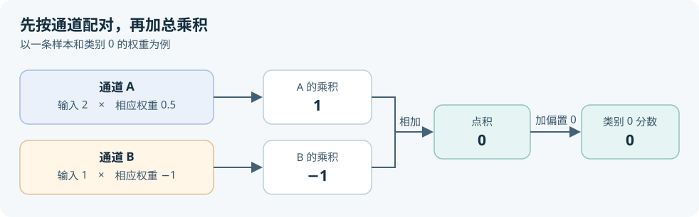
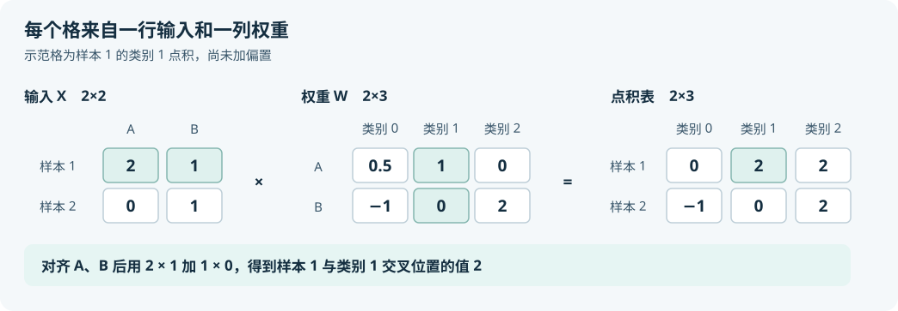
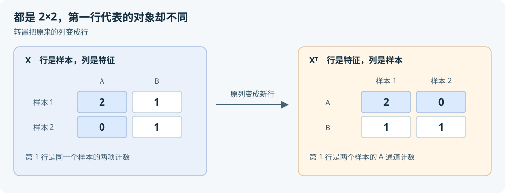

# K01-06 一次算一批

上一章你用九个参数算了一行输入。数据有 16 行，真实任务里的数据还要多得多。这一章把很多行排在一起一次算完。

算法没有变，还是乘和加。新增的是一套记账的办法：把数排成向量和矩阵，用**形状**核对能不能算，用**轴**说明每个位置代表什么。这套办法从这里一直用到课程结束，后面讲语言模型时，“这一步结果的形状是什么”会反复出现。

这一章有一条贯穿的提醒：**形状对了，只说明能算；算出来的数有没有意义，要另外核对。**

<a id="vector"></a>

## 一行输入是一个向量

**这节在干嘛**　给上一章的“乘加”起一个名字，以后可以一句话说清。

**向量**就是排成一排的数，位置有含义。上一章的输入 a=2、b=1 写成向量是 [2, 1]：第一个位置是通道 A 的超时次数，第二个位置是通道 B 的。类别 0 的两个权重也可以写成一个向量 [0.5, −1]，位置的含义与输入一一对应。

两个一样长的向量，对应位置相乘，再把乘积加起来，叫**点积**：

    [2, 1] 与 [0.5, −1] 的点积 = 2×0.5 + 1×(−1) = 0



所以上一章的算式可以重新说一遍：**某个类别的分数 = 输入与这个类别的权重做点积，再加这个类别的偏置。** 三个类别就是三次点积：

| 类别 | 输入 | 这个类别的权重 | 点积 | 加偏置 | 分数 |
| --- | --- | --- | ---: | ---: | ---: |
| 0 | [2, 1] | [0.5, −1] | 0 | 0 | 0 |
| 1 | [2, 1] | [1, 0] | 2 | 0.5 | 2.5 |
| 2 | [2, 1] | [0, 2] | 2 | −1 | 1 |

点积要求两个向量一样长，而且同一个位置说的是同一件事。输入的第一个位置是 A，权重的第一个位置就必须是给 A 的权重。

<a id="matrix"></a>

## 两行一起算：矩阵和形状

**这节在干嘛**　把两行输入摞起来，一次算出两行各自的三个分数。

取两行输入：样本 1 是 a=2、b=1，样本 2 是 a=0、b=1。把它们一行一行摞起来，得到一个**矩阵**，记作 X：

| | a | b |
| --- | ---: | ---: |
| 样本 1 | 2 | 1 |
| 样本 2 | 0 | 1 |

九个参数里的六个权重本来就是一张表，记作 W：

| | 类别 0 | 类别 1 | 类别 2 |
| --- | ---: | ---: | ---: |
| a | 0.5 | 1 | 0 |
| b | −1 | 0 | 2 |

一个矩阵有几行几列，叫它的**形状**。X 是 2 行 2 列，写作 [2, 2]；W 是 2 行 3 列，写作 [2, 3]。

**矩阵乘法**做的事情，就是把上一节的点积做遍所有的搭配：X 的每一行，与 W 的每一列，各做一次点积。X 有 2 行，W 有 3 列，一共 6 次点积，结果排成 2 行 3 列。



图里标出的那一格是样本 1 与类别 1：X 的第 1 行 [2, 1]，W 的类别 1 那一列 [1, 0]，点积是 2。

乘完以后，给每一行都加上三个偏置 [0, 0.5, −1]：

| | 类别 0 | 类别 1 | 类别 2 | 选 |
| --- | ---: | ---: | ---: | --- |
| 样本 1 | 0 | 2.5 | 1 | 类别 1 |
| 样本 2 | −1 | 0.5 | 1 | 类别 2 |

让程序算一遍：

```bash
python3 v2/06-math/lab.py
```

**用单行的乘加自检。** 样本 2 的类别 0 分数，按上一章的办法是 0×0.5 + 1×(−1) + 0 = −1，与表里一致。再挑一格自己验一下。批量计算没有引入任何新的算术，它只是把同样的乘加一次做完；每一行用的是同一组参数，行与行之间互不影响。所以任何时候拿不准，都可以抽一行用单行的办法核对。

形状有一条简单的规矩：

    [行数, 2] 乘 [2, 3] 得到 [行数, 3]

中间挨着的两个数必须相等：X 的列数等于 W 的行数，点积才能配上对。结果的形状取外面的两个数。

写成代码。输入里已经有一个 b，所以偏置在代码和公式里写作 bias：

```python
def batch_forward(X, W, bias):
    """X 的形状是 [行数, 2]，W 是 [2, 3]，bias 是 [3]。返回 [行数, 3]：每行三个分数。"""
    return [[sum(x[i] * W[i][k] for i in range(2)) + bias[k] for k in range(3)] for x in X]
```

<a id="axes"></a>

## 每个轴代表什么

**这节在干嘛**　形状只告诉你有几行几列。这一节给行和列各自安上含义。

矩阵的行方向和列方向，各叫一个**轴**。说一个矩阵，除了形状，还要说清每个轴代表什么：

| | 形状 | 行代表 | 列代表 |
| --- | --- | --- | --- |
| 输入 X | [2, 2] | 样本 | 特征（a、b） |
| 权重 W | [2, 3] | 特征（a、b） | 类别（0、1、2） |
| 偏置 bias | [3] | | 类别 |
| 结果 | [2, 3] | 样本 | 类别 |

X 的行这个轴叫**样本轴**，列这个轴叫**特征轴**。

有了这张表，结果里的每个数都能说清来历。结果第 2 行、类别 2 那一列的 1，是“样本 2 在类别 2 上的分数”。

也能看出矩阵乘法为什么要求“中间的两个数相等”：X 的列是特征，W 的行也是特征，点积正是沿着特征这个轴一项一项配对的。**不仅数目要相等，含义和顺序也要相同。** 数目相等，程序能检查；含义和顺序，程序不知道。

<a id="shape-error"></a>

## 形状对不上：程序会拦住

**这节在干嘛**　看一种会被程序发现的错误。

假设每行输入被多塞了一个数，X 变成 2 行 3 列。X 的列数是 3，W 的行数是 2，点积配不上对：

```bash
python3 v2/06-math/lab.py --fault shape
```

```text
这次故意给每行输入多加了一个数：X 的形状是 [2, 3]，W 的形状是 [2, 3]。
形状检查没有通过，计算没有执行：X 的列数 3 需与 W 的行数 2 相同。
```

这类错误容易处理。计算在开始之前就停了，报错直接说出哪两个数不相等。

<a id="axis-error"></a>

## 形状对得上，含义错了

**这节在干嘛**　看一种程序发现不了的错误。这是本章最要紧的一节。

先做一道题。

> 同事整理数据时，把表按“每一行是一条通道，每一列是一条样本”存了下来。原来的两行输入 [2, 1] 和 [0, 1]，在他的文件里是 [2, 0] 和 [1, 1]。这份数据被直接送进了模型。程序没有报错，输出也是 2 行 3 列。结果能用吗？

先想一想，再运行：

```bash
python3 v2/06-math/lab.py --fault axis
```

```text
这次故意把 X 的行和列对调了：
  对调后的 X = [[2, 0], [1, 1]]，形状仍然是 [2, 2]，程序没有报错。
  算出的结果 = [[1, 2.5, -1], [-0.5, 1.5, 1]]，与上面的结果不同。
```

把矩阵的行和列对调，叫**转置**。这里的 X 恰好是 2 行 2 列，转置以后形状不变，形状检查照样通过。



可是含义全变了。转置后的第一行 [2, 0] 是“两条样本各自的 A 通道次数”，程序却把它当成“一条样本的 a 和 b”去和权重做点积。算出来的 [1, 2.5, −1] 不再对应这批数据里原来的任何一条样本。

实验的输出还给了同一类错误的另一个例子：一行里的两个数前后放反了。a=2、b=1 被写成 [1, 2]，程序按“先 a 后 b”去读，得到 −1.5、1.5、3。形状没有任何问题，分数全错。

这和上一章“按错误的约定读参数文件”是同一种错误：**每个数都合法，位置的含义错了，程序不会报错。**

能做的防范有三条：

- **把每个轴的含义写下来。** 写在代码的注释、变量名或数据文件的说明里，就像上一节那张表。
- **抽一行自检。** 拿一条知道答案的样本，用单行的乘加算一遍，与批量的结果对照。要把整行的三个分数都对上，只对一个数不够：这个例子里，转置以后的结果有两格碰巧和正确的结果相同。
- **让行数和列数尽量不相等。** 2 行 2 列的矩阵转置以后查不出来；如果是 16 行 2 列，转置成 2 行 16 列，形状检查就能拦住。这条只能减少碰巧，不能代替前两条。

<a id="all"></a>

## 把 16 行一起算

**这节在干嘛**　用刚学的办法，一次算完全部数据，看这组参数到底做得怎样。

把 16 行输入摞成 16 行 2 列的 X。先预测：结果的形状是什么？

```bash
python3 v2/06-math/lab.py --all
```

[16, 2] 乘 [2, 3]，结果是 [16, 3]：16 行，每行三个分数。程序同时列出了每一行选的类别和标签：

```text
a0-b0    [0, 0]  [0, 0.5, -1]       1   0   错
a0-b1    [0, 1]  [-1, 0.5, 1]       2   0   错
…
a2-b0    [2, 0]  [1, 2.5, -1]       1   1   对
…
这组手设的参数在 16 行里选对 7 行。参数没有经过训练。
```

16 行里选对 7 行。这组参数是随手设的，这个成绩不奇怪。

<a id="formula"></a>

## 公式（可以跳过）

把前面的内容写成记号。X 的形状是 [N, 2]，W 是 [2, 3]，bias 是 [3]，结果 Z 是 [N, 3]：

    Z = X·W + bias
    Z[n][k] = X[n][0]×W[0][k] + X[n][1]×W[1][k] + bias[k]

n 是第几条样本，k 是第几个类别。读后面的章，知道“X·W 是每一行与每一列做点积”就够了。

<a id="quiz"></a>

## 四道小测：形状和含义

<details><summary>1. X 的形状是 [5, 2]，W 是 [2, 3]，bias 是 [3]。结果的形状是什么？结果第 4 行、类别 0 那一列的数代表什么？</summary><p>结果是 [5, 3]。那个数是第 4 条样本在类别 0 上的分数。</p></details>

<details><summary>2. 算出 [3, 1] 与 [1, 0] 的点积。它是哪一行输入在哪个类别上、加偏置之前的值？</summary><p>3×1 + 1×0 = 3。[1, 0] 是类别 1 的权重，所以这是 a=3、b=1 这一行在类别 1 上加偏置之前的值。加上偏置 0.5，分数是 3.5，与上一章换输入时算出的一致。</p></details>

<details><summary>3. 如果每条样本多了第三项输入，W 的形状要怎样变？参数一共多少个？</summary><p>X 变成 [行数, 3]，W 的行数必须跟着变成 3，形状是 [3, 3]；偏置还是 3 个。参数一共 9 + 3 = 12 个。</p></details>

<details><summary>4. 一份 2 行 2 列的输入被转置以后送进了模型，程序没有报错。举出一种能发现这个错误的办法。</summary><p>拿其中一条知道答案的样本，用单行的乘加算出三个分数，再与批量结果里对应的那一行比较，两者对不上就说明输入的排法有问题。平时把每个轴的含义写清楚，并在读入数据时核对，也能提前避免。只看形状发现不了：转置前后都是 [2, 2]。</p></details>

<a id="next"></a>

## 只做乘加，能把 16 行全部分对吗

到这里，你能把一批输入一次算成一批分数，能用形状判断一次计算做不做得了，也知道形状之外还要核对含义。

16 行只选对 7 行，是因为参数是随手设的。那么换一组更好的参数，能不能把 16 行全部选对？[第 07 章](../07-hidden/lesson.md)会看到：对这种只做乘加的模型，答案是不能，无论参数怎样取。原因和补救的办法，都在下一章。
