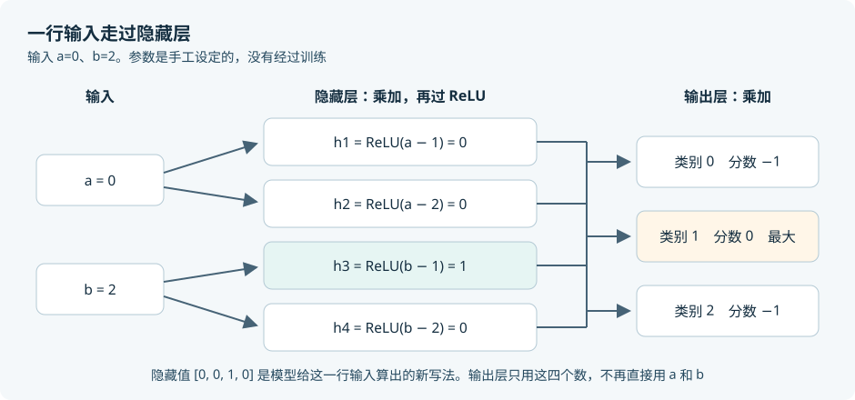

# K01-07 一层不够

上一章结尾，那组手设的参数在 16 行里只选对 7 行。参数是随手设的，这不奇怪。真正的问题是：**换一组更好的参数，这种只做乘加的模型能不能把 16 行全部选对？**

这一章先说明答案是不能，而且只用三行数据就能说明；再看这个结论的适用范围；然后给模型加一样东西，让它装得下正确的做法，并跟着一行输入把新的计算走一遍。

这一章是阶段二里偏重的一章。新的算术只有一条：取 0 和一个数当中较大的那个。

<a id="three-rows"></a>

## 三行数据就能说明问题

**这节在干嘛**　不用试遍所有参数，只看三行数据，就能断定只做乘加的模型至少错一行。

从 16 行里挑出三行，它们都在训练数据里：

| a | b | 标签 |
| ---: | ---: | --- |
| 0 | 2 | 1 |
| 2 | 0 | 1 |
| 1 | 1 | 0 |

第三行有个特别之处：它正好在前两行的**正中间**。a 是 0 和 2 的平均，b 是 2 和 0 的平均。

前两章的模型只做乘加。这种模型有一个性质：**输入取了平均，每个分数也跟着取平均。** 用上一章那组参数验一下：

| | 类别 0 的分数 | 类别 1 的分数 | 类别 1 减类别 0 |
| --- | ---: | ---: | ---: |
| a=0、b=2 | −2 | 0.5 | 2.5 |
| a=2、b=0 | 1 | 2.5 | 1.5 |
| 两行的平均 | −0.5 | 1.5 | 2 |
| a=1、b=1 | −0.5 | 1.5 | 2 |

中间一行的每个数，都等于两端的平均。这不是这组参数的巧合。分数的算式是 a 乘一个权重、b 乘一个权重、再加偏置；把 a、b 换成两行的平均，乘出来的也是两行的平均，偏置不变，加起来还是平均。

现在推理只剩三步：

1. 要选对两端，模型在 a=0、b=2 和 a=2、b=0 上都得选类别 1。本课约定分数并列时取编号较小的类别，所以要选中类别 1，它的分数必须严格高于类别 0。于是在这两行上，“类别 1 减类别 0”都大于 0。
2. 中间一行的“类别 1 减类别 0”是两端的平均。两个大于 0 的数取平均，还是大于 0。
3. 所以在 a=1、b=1 上，类别 1 的分数也比类别 0 高，模型不可能选类别 0。而这一行的标签正是 0。

**两端选对了，中间就一定选错。三行里至少错一行，九个参数怎样取都一样。**

按[课程导读的实验准备](../ABOUT.md#lab-setup)进入仓库根目录，让程序把这张表算出来，再随机换一组参数看看：

```bash
python3 v2/07-hidden/lab.py --linear-limit
python3 v2/07-hidden/lab.py --linear-limit --seed 7
```

两次输出里，“两端的差取平均”与“中间一行的差”都相同。程序还随机试了一万组参数：三行全对的一组也没有，最多对两行。随机尝试不能代替上面的推理，它只是让你看到推理说的事情确实在发生。

所以对上一章结尾的问题，答案是不能。16 行里包含这三行，全对是做不到的。

<a id="scope"></a>

## 这个结论的范围

**这节在干嘛**　说清“做不到”的前提，免得把它记成一句太宽的话。

结论是：**只做乘加的模型，在输入是 a、b 这两个原始次数时，做不对这道题。** 后半句的条件不能丢。

换一种输入就不一样了。假设交给模型的不是次数，而是两个已经判断好的数：u 表示 A 是否达到 2 次，v 表示 B 是否达到 2 次，各取 0 或 1。原来的三行变成：

| 原来的 a、b | 换成 u、v | 标签 |
| --- | --- | --- |
| 0、2 | 0、1 | 1 |
| 2、0 | 1、0 | 1 |
| 1、1 | 0、0 | 0 |

第三行不再是前两行的中间了，刚才的推理用不上。实际上，这时只做乘加的模型完全够用：让三个类别给 u、v 的权重分别是 −2、0、2，偏置分别是 1、0、−3，16 行全对。

可见困难不在题目本身，在于“只做乘加”和“输入是原始次数”这个组合。出路有两条：

- **由人把输入换成更合适的写法。** 这要求人事先知道哪种写法合适。这道小题我们知道规则，真实任务往往不知道。
- **让模型自己从原始输入算出一种更合适的写法，再在它上面做乘加。** 这是神经网络走的路，也是本章后半的内容。

<a id="no-relu"></a>

## 多叠一层乘加，没有用

**这节在干嘛**　排除一个很自然的想法，为下一节要加的东西找到位置。

既然要让模型“先算出一种新写法”，最自然的做法是在中间加一层：先用一组权重和偏置把两个输入算成四个中间值，再用另一组把四个中间值算成三个分数。

如果两层都只做乘加，这没有用。乘加之后再乘加，合起来仍然是一次乘加：输入取了平均，中间值跟着取平均，分数也跟着取平均。三行数据的那个推理原封不动地成立。完整的推导放在本章末尾的选读里。等后面把完整的两层网络走通，再回来用实验看这件事。

所以要加的不是又一层乘加，而是夹在两层之间的另一种计算。

<a id="relu"></a>

## 加一步：小于 0 就变成 0

**这节在干嘛**　认识要加进去的那一步，看它凭什么打破“取平均”。

这一步叫 **ReLU**，算法只有一句话：**取 0 和这个数当中较大的那个。** 正数原样通过，负数变成 0。

| 输入 | −2 | −1 | 0 | 1 | 2 |
| --- | ---: | ---: | ---: | ---: | ---: |
| ReLU 之后 | 0 | 0 | 0 | 1 | 2 |

它不守“取平均”的规矩：−1 和 1 的平均是 0，ReLU(0) 是 0；可 ReLU(−1) 和 ReLU(1) 的平均是 0.5。两者不相等。像这样不守这条规矩的计算，叫**非线性**的；夹在两层乘加之间的非线性步骤，叫**激活函数**。ReLU 是很常用的一种。

别看它简单。用两个带 ReLU 的单元，就能做出乘加做不到的事。看 a 的四种取值：

| a | ReLU(a − 1) | ReLU(a − 2) | 前一个减后一个 |
| ---: | ---: | ---: | ---: |
| 0 | 0 | 0 | 0 |
| 1 | 0 | 0 | 0 |
| 2 | 1 | 0 | 1 |
| 3 | 2 | 1 | 1 |

最后一列正是“A 是否达到 2 次”：0、0、1、1。上一节说的那种更合适的写法 u，被两个 ReLU 单元算出来了。对 b 用同样的两个单元，就得到 v。

<a id="trace"></a>

## 跟着一行输入走一遍

**这节在干嘛**　认识带隐藏层的网络，并亲手跟踪一条计算路径。

现在的模型分两层：

- **隐藏层**：两个输入先乘加成四个数，再各自过 ReLU，得到四个**隐藏值**，记作 h1 到 h4。“隐藏”的意思只是它们既不是输入也不是最后的输出。
- **输出层**：四个隐藏值再乘加一次，得到三个分数。

参数多了：第一层的权重是 2 行 4 列，偏置 4 个；第二层的权重是 4 行 3 列，偏置 3 个。一共 8 + 4 + 12 + 3 = 27 个。

这一章用的 27 个参数仍然是**手工设定**的。四个隐藏单元照着上一节的想法设：

    h1 = ReLU(a − 1)    h2 = ReLU(a − 2)    h3 = ReLU(b − 1)    h4 = ReLU(b − 2)

输出层先算 c = h1 − h2 + h3 − h4。按上一节那张表，h1 − h2 是“A 是否达到 2 次”，h3 − h4 是“B 是否达到 2 次”，所以 c 就是达到 2 次的通道数。三个分数取 1 − 2c、0、2c − 3：

| c | 类别 0 的分数 | 类别 1 的分数 | 类别 2 的分数 | 最大的是 |
| ---: | ---: | ---: | ---: | --- |
| 0 | 1 | 0 | −3 | 类别 0 |
| 1 | −1 | 0 | −1 | 类别 1 |
| 2 | −3 | 0 | 1 | 类别 2 |

拿 a=0、b=2 走一遍：

```bash
python3 v2/07-hidden/lab.py
```



| 步 | 做什么 | 结果 | 结果的形状 |
| --- | --- | --- | --- |
| ① | 两个输入乘第一层的权重，加偏置 | −1、−2、1、0 | 4 个数 |
| ② | 各自过 ReLU | 0、0、1、0 | 4 个数 |
| ③ | 四个隐藏值乘第二层的权重，加偏置 | −1、0、−1 | 3 个数 |
| ④ | 取最大 | 类别 1 | |

第 ① 步的四个数就是 a − 1、a − 2、b − 1、b − 2。第 ③ 步里 c = 0 − 0 + 1 − 0 = 1，三个分数是 1 − 2、0、2 − 3。标签是 1，选对了。

用上一章的话说，第 ① 步是 [1, 2] 乘 [2, 4]，得到 [1, 4]；第 ③ 步是 [1, 4] 乘 [4, 3]，得到 [1, 3]。中间的 ReLU 不改变形状。

**自己跟一行：a=3、b=1。** 先在纸上写出四步的结果，再运行核对：

```bash
python3 v2/07-hidden/lab.py --a 3 --b 1
```

<details><summary>答案</summary><p>① 2、1、0、−1。② 2、1、0、0。③ c = 2 − 1 + 0 − 0 = 1，三个分数是 −1、0、−1。④ 类别 1。标签也是 1：只有 A 达到 2 次。注意 h1 和 h2 都不是 0，是它们相减得到了 1。</p></details>

再看全部 16 行：

```bash
python3 v2/07-hidden/lab.py --all
```

16 行全对。开头那三行也在里面：a=0、b=2 和 a=2、b=0 选类别 1，中间的 a=1、b=1 选类别 0。

现在回头看“多叠一层乘加，没有用”那句话。把这个网络的 ReLU 去掉，只留两层乘加：

```bash
python3 v2/07-hidden/lab.py --all --no-relu
```

16 行只选对 4 行。去掉 ReLU，它就退回成一个只做乘加的模型。这次 16 行算出的三个分数还完全一样，都是 −3、0、1；这是这组手设参数互相抵消造成的，不是两层乘加都会这样，选读里把它算了出来。

<a id="representation"></a>

## 隐藏值是一种中间表示

**这节在干嘛**　说清隐藏层到底起了什么作用，以及这个例子没有说明什么。

把一行输入换一种写法，叫给它一种**表示**。原始的表示是两个次数 a、b；隐藏层算出的四个隐藏值，是同一行输入的另一种表示，叫**中间表示**。

输出层自己仍然只做乘加。它之所以够用，是因为它面对的不再是原始次数，而是隐藏值。前面“这个结论的范围”一节里说的第二条出路，就是这样实现的：**模型先算出一种表示，再在这种表示上做简单的计算。**

这个例子里，中间表示是我们照着规则设计的，每个隐藏值的含义一目了然。训练出来的网络不是这样：隐藏值是训练找到的，通常看不出哪个数代表什么。第 10 章会看到一组训练得到的参数，第 14 章还会再遇到这件事。

最后把这个例子的结论限定清楚。

- **它说明了什么：** 2 个输入、4 个隐藏单元、3 个类别的这种结构，装得下一组把 16 行全部做对的参数。也就是说，结构本身够用。
- **它没有说明什么：** 这 27 个参数是我们知道规则以后直接写出来的。让程序只看 10 行训练数据，自己把参数调出来，能不能调到同样好？这是另一个问题，要到第 09、10 章用实际的训练来回答。

<a id="optional"></a>

## 选读：两层乘加为什么还是一层

这一节可以跳过，后面的章不依赖它。

设第一层的权重是 W1、偏置是 b1，第二层是 W2、b2，中间不加 ReLU。按上一章的记号：

    中间值 = X·W1 + b1
    分数 = 中间值·W2 + b2 = X·(W1·W2) + (b1·W2 + b2)

W1·W2 是一个 2 行 3 列的矩阵，b1·W2 + b2 是 3 个数。所以这两层合起来，就是一个权重为 W1·W2、偏置为 b1·W2 + b2 的单层乘加模型，仍然只有 9 个起作用的数。不管叠多少层，只要中间没有非线性的步骤，都可以这样合并成一层。

把本章手设的参数代进去：W1·W2 的六个数全是 0，b1·W2 + b2 是 −3、0、1。这正是去掉 ReLU 以后看到的结果：分数与输入无关，恒为 −3、0、1。

<a id="quiz"></a>

## 四道小测：非线性与隐藏层

<details><summary>1. ReLU(−3)、ReLU(0)、ReLU(2.5) 各是多少？</summary><p>0、0、2.5。</p></details>

<details><summary>2. 用本章手设的网络，手算 a=2、b=2 的四步结果。</summary><p>① 1、0、1、0。② 1、0、1、0。③ c = 1 − 0 + 1 − 0 = 2，三个分数是 −3、0、1。④ 类别 2。标签也是 2。可以运行 <code>python3 v2/07-hidden/lab.py --a 2 --b 2</code> 核对。</p></details>

<details><summary>3. “只做乘加的模型做不对这道题”，为什么要加上“在输入是原始次数时”这个条件？</summary><p>因为那个推理依赖“a=1、b=1 正好是另外两行的中间”。把输入换成“是否达到 2 次”的两个 0/1 数以后，这三行不再有这种位置关系，只做乘加的模型就能把 16 行全部做对。做不到的原因是模型和输入表示的组合，不是题目本身。</p></details>

<details><summary>4. 手设的网络在 16 行上全对。能据此说“这种网络训练以后会把 16 行全部做对”吗？</summary><p>不能。手设的参数只说明这种结构装得下一组正确的参数。训练是让程序从 10 行训练数据出发自己调参数，能不能调到同样好，要看实际训练的结果。</p></details>

<a id="next"></a>

## 都选对了，谁更好

到这里，你知道了只做乘加的模型为什么不够，也跟着一行输入走过了带隐藏层的计算。

接下来要让程序自己去调这 27 个参数。调参数需要一个比“选对几行”更细的尺子：同样是选对，分数是 −1、0、−1，还是 −3、0、−3，哪一个更好？参数稍微动一点，选对的行数往往不变，那怎么知道是变好了还是变坏了？[第 08 章](../08-loss/lesson.md)把分数变成概率，再给“好坏”一个可以计算的数。
