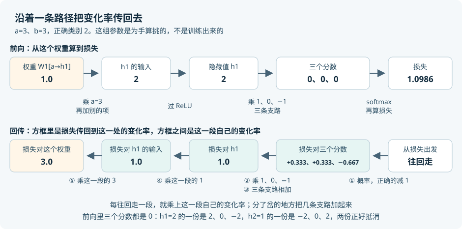

# K01-09 参数怎样学

到上一章为止，你能回答“这组参数在这些数据上做得怎样”：算出平均损失，越小越好。于是“让模型变好”成了一件明确的事：调整参数，让损失变小。

可这个小网络有 27 个参数。损失偏大的时候，该动哪一个？往大了调还是往小了调？调多少？一个一个瞎试没有方向，参数再多一些就根本试不过来。

这一章分两步回答。先看离输出最近的参数：把它拨一点，看损失怎样变，再照着改一次。再看隔着两层的参数：它拨一点，损失会怎样变，不靠试能不能算出来。

**这是阶段二里最重的一章，建议分两次学。** 第一次学到“照着变化率改一次”为止，那里有三道小测；第二次从“隔着两层的参数”开始。

本章会换三次参数，都不是训练的结果，每次换的时候都会标明。

<a id="nudge"></a>

## 拨一点，看损失怎样变

**这节在干嘛**　用最笨也最直接的办法，找出一个参数该往哪边调。

先挑一组便于手算的数。隐藏层照旧，输出层的权重全设成 0，三个输出偏置也都是 0。这样不管输入是什么，三个分数都是 0。

拿一行数据来看：a=0、b=2，正确类别是 1。

- 三个分数是 0、0、0，三个概率各是三分之一。
- 正确类别的概率是 0.333333，损失是 1.098612。这正是上一章说的“三类平分”。

现在只动三个输出偏置。把它们各自加上 0.001，别的都不动，每次重新算一遍损失：

| 拨动哪一个 | 损失的变化 | 换算成“每拨 1 变多少” |
| --- | ---: | ---: |
| 类别 0 的偏置 | +0.000333 | +0.333 |
| 类别 1 的偏置 | −0.000667 | −0.667 |
| 类别 2 的偏置 | +0.000333 | +0.333 |

按[课程导读的实验准备](../ABOUT.md#lab-setup)进入仓库根目录，运行：

```bash
python3 v2/09-update/lab.py
```

这张表已经给出了方向。正确类别是 1：把类别 1 的偏置拨大，损失下降；把另外两个拨大，损失上升。

最后一列叫**变化率**：一个参数增加一点点时，损失跟着变多少，按比例换算成“每增加 1”。正号表示拨大会让损失变大，负号表示拨大会让损失变小。全部参数的变化率放在一起，叫**梯度**。下面把某个参数的变化率，也叫作这个参数的梯度。

这个办法叫**拨动法**。它不需要任何新的数学，只要会算损失。

表里的数是拨动 0.001 得到的估计。拨得小一些，估计通常更准；小到一定程度，计算机的舍入误差会反过来变大。它们逼近的准确值有一个现成的规律：**三个概率，正确类别的那一个减去 1。** 三个概率是 1/3、1/3、1/3，正确类别是 1，于是：

    类别 0：1/3 − 0 = +0.333
    类别 1：1/3 − 1 = −0.667
    类别 2：1/3 − 0 = +0.333

这条规律对任何一组分数都成立，不限于这个例子：**损失对每个分数的变化率，等于模型给这个类别的概率，正确类别再减 1。** 输出偏置直接加在分数上，所以它的变化率与分数的相同。程序就是按这条规律直接算的，不必真的去拨。它读起来也合情理：正确类别的概率还不到 1，差多少，就有多大的力气把它往上推；别的类别占了多少概率，就有多大的力气把它往下压。

为什么恰好是这样，放在本章末尾的选读里。这里只要会用，并且知道它随时可以用拨动法核对。

<a id="update"></a>

## 照着变化率改一次

**这节在干嘛**　方向有了，定下改多少，完成一次真正的更新。

做法是：**每个参数都朝着让损失变小的方向挪一步，步子的大小是变化率乘一个系数。** 这个系数叫**学习率**，是人定的，这里取 0.3。

    新的值 = 旧的值 − 学习率 × 变化率

变化率是正的，说明拨大了损失会涨，所以要减；变化率是负的，减去一个负数就是加。

| | 旧的值 | 变化率 | 新的值 |
| --- | ---: | ---: | ---: |
| 类别 0 的偏置 | 0 | +0.333333 | −0.1 |
| 类别 1 的偏置 | 0 | −0.666667 | +0.2 |
| 类别 2 的偏置 | 0 | +0.333333 | −0.1 |

三个新的值都是用**同一组旧的值**算出来的，算完再一起换上去。不能改完第一个，再用改过的状态去算第二个的变化率。

换上新的值，从头复算：

- 三个分数变成 −0.1、0.2、−0.1。
- 正确类别的概率从 0.333333 升到 0.402960。
- 损失从 1.098612 降到 0.908918。

这就是**一次更新**。损失确实变小了。

写成代码，一次更新只有一行：

```python
def update(values, slopes, learning_rate):
    """values 是全部参数，slopes 是同一个旧状态下算出的全部变化率。"""
    return [value - learning_rate * slope for value, slope in zip(values, slopes)]
```

有一点要留意。按变化率估算，这一步应当让损失下降 0.2：三个偏置分别挪了 −0.1、+0.2、−0.1，各自乘上变化率再相加，是 −0.033 − 0.133 − 0.033。实际只下降了 0.189694。

变化率说的是“拨一点点”时的情况。步子迈大了，它就只是近似。由此有两个后果：

- **学习率不能随便取大。** 步子太大，估算和实际差得远，损失甚至可能不降反升。
- **每挪一步，都要在新的位置重新算变化率。** 上一步的变化率在新位置已经不准了。

<a id="quiz-first"></a>

### 第一次学到这里：三道小测

前半章的内容是：变化率告诉每个参数该往哪边调，学习率决定调多少，所有参数用同一个旧状态一起更新。下面三道题只用到这些，做完再往下读，或者下次再接着读。

<details><summary>1. 一个参数的变化率是 −2，学习率是 0.1。更新以后它变大还是变小？变多少？</summary><p>变大 0.2。新的值 = 旧的值 − 0.1 × (−2) = 旧的值 + 0.2。变化率是负的，说明把它拨大损失会下降，所以更新让它变大。</p></details>

<details><summary>2. 某一行的三个概率是 0.2、0.5、0.3，正确类别是 2。损失对三个分数的变化率各是多少？三个输出偏置各该往哪边调？</summary><p>概率减去正确类别的那个 1：+0.2、+0.5、−0.7。类别 2 的偏置该调大，另外两个该调小。两个该调小的里面，类别 1 的偏置调得更多，因为它占走的概率更多。</p></details>

<details><summary>3. 更新参数时，为什么要先用旧的状态把所有变化率算完，再一起改？</summary><p>因为每个变化率说的都是“在当前这个状态下，这个参数变一点，损失怎样变”。如果改完一个参数再去算下一个，后一个变化率对应的就是另一个状态，这一步就不再是对同一个位置的调整，结果也会依赖参数的排列顺序。</p></details>

<a id="chain"></a>

## 隔着两层的参数

**这节在干嘛**　对离损失远的参数，不靠拨动，把它的变化率一段一段算出来。

输出偏置离损失最近，拨它一下，分数直接跟着变。第一层的权重没这么直接：它先影响一个隐藏层的输入，过了 ReLU 成为隐藏值，隐藏值再通向三个分数，三个分数再决定损失。

当然可以照旧去拨。可拨动法每问一个参数，就要把损失重新算一遍。这里想要的是一个不用重算、沿着计算过程直接推出来的办法。

换一组便于手算的数，同样不是训练出来的：隐藏层用第 07 章手设的那四个单元；输出层只让 h1 和 h2 通向三个分数，偏置都是 0。

| 输出层的参数 | 类别 0 | 类别 1 | 类别 2 |
| --- | ---: | ---: | ---: |
| h1 的权重 | 1 | 0 | −1 |
| h2 的权重 | −2 | 0 | 2 |
| h3、h4 的权重 | 0 | 0 | 0 |
| 输出偏置 | 0 | 0 | 0 |

拿 a=3、b=3、正确类别 2 这一行来看。要问的是第一层里从 a 通向 h1 的那个权重，它现在是 1.0。

先做前向计算：四个隐藏层的输入是 2、1、2、1，都大于 0，所以隐藏值也是 2、1、2、1。只有 h1=2 和 h2=1 通向输出，三个分数是 2×1 + 1×(−2) = 0、2×0 + 1×0 = 0、2×(−1) + 1×2 = 0。概率各三分之一，损失 1.098612。

然后沿着计算的路径**往回走**。每走到一处，要分清两个数：

- **这一段自己的变化率**：只看相邻的两处，前一处变一点，后一处跟着变多少。
- **损失传回到这里的变化率**：这一处变一点，损失最后变多少。它等于上一步传回来的数，乘上这一段自己的变化率。



| 步 | 走到哪里 | 这一段自己的变化率 | 损失传回到这里的变化率 |
| --- | --- | --- | --- |
| ① | 三个分数 | 起点，直接从损失算 | 三个概率，正确类别的那一个减 1：+0.333333、+0.333333、−0.666667 |
| ② | 从三个分数到 h1 的三条支路 | h1 变一点，三个分数各变多少：h1 通向它们的权重 1、0、−1 | 每条支路各自相乘：1×0.333333、0×0.333333、(−1)×(−0.666667) |
| ③ | 隐藏值 h1 | | 三条支路相加：0.333333 + 0 + 0.666667 = 1.0 |
| ④ | h1 的输入 | h1 的输入变一点，h1 变多少：输入是 2，大于 0，ReLU 原样通过，是 1 | 上一步的 1.0 × 1 = 1.0 |
| ⑤ | 从 a 通向 h1 的权重 | 这个权重变一点，h1 的输入变多少：它乘的是 a，是 3 | 上一步的 1.0 × 3 = 3.0 |

所以这个权重的变化率是 3.0：把它拨大，损失上升，应当往小了调。

第 ③ 步和第 ④ 步的结果都是 1.0，只是凑巧。前一个 1.0 是损失传到 h1 的变化率，后一个是它乘上 ReLU 这一段的 1 得到的。下一节换一个条件，两者就不一样了。

```bash
python3 v2/09-update/lab.py --chain
```

第 ① 步用的就是上一节那条规律，只是正确类别换成了 2。后面四步只用到乘法和加法。

这条路径上有三件事值得记住：

- **一段一段相乘。** 权重到隐藏层的输入，隐藏层的输入到隐藏值，隐藏值到分数，分数到损失。每一段各有一个变化率，连起来就是把它们乘在一起。
- **分了岔就相加。** h1 同时通向三个分数，三条支路各自的贡献要加在一起。
- **ReLU 是一道闸。** 隐藏层的输入大于 0 时，变化原样通过。小于 0 时隐藏值恒为 0，这个单元后面发生的事传不回来，它前面的权重在这一行数据上的变化率就是 0。输入正好等于 0 是折点，往两边拨的结果不一样，严格说那里没有变化率；本课的程序约定这时按 0 处理。

这样从损失出发、沿着计算路径往回算出每个参数的变化率，叫**反向传播**。它要用的参数和中间值，前向计算时都已经有了；各处的变化率是往回走的时候算的。

算出来的 3.0 对不对，用拨动法核对：把这个权重从 1.0 加到 1.001，损失从 1.098612 变成 1.101615，涨了 0.003003，约等于 3.0 × 0.001。

<a id="predict"></a>

## 换一个条件，先预测再核对

**这节在干嘛**　检验你是不是真的会沿着路径算。

还是上一节那组手算的参数，a=3、b=3，问的还是从 a 通向 h1 的权重。这次暂时把这一行的标签当成 0 来算。

这只是一道计算练习。按第 04 章的标注规则，a=3、b=3 的标签是 2，这一点不会变；这里换掉标签，是为了看标签怎样决定调整的方向。

先自己沿五步算一遍：变化率是正还是负？是多少？这个权重该往哪边调？

```bash
python3 v2/09-update/lab.py --chain --label 0
```

<details><summary>答案</summary><p>前向计算不变，三个概率仍是各三分之一。第 ① 步变成 −0.666667、+0.333333、+0.333333。第 ②③ 步：1×(−0.666667) + 0×0.333333 + (−1)×0.333333 = −1.0。第 ④ 步，ReLU 这一段自己的变化率仍然是 1，传回来的是 −1.0 × 1 = −1.0。第 ⑤ 步乘上 a=3，变化率是 −3.0。标签换了，同一个权重该调的方向就反过来了：这次应当往大了调。</p></details>

参数该往哪边调，不由参数自己决定，由数据的标签决定。同一个权重，对这一行可能该调大，对另一行可能该调小。有很多行时取的是平均，各行互相抵消一部分，剩下的才是这一步的方向。

<a id="check"></a>

## 程序算的靠不靠得住

**这节在干嘛**　两种算法应当得到同样的结果。让它们互相核对。

程序把短链那一节的办法用在全部 27 个参数上：每行数据做一遍前向计算，再沿路径往回走一遍，27 个变化率就都有了。有多行数据时，每个参数的变化率是各行的平均，因为要降低的是平均损失。

拨动法也能算出同样的 27 个数，办法笨一些：每个参数向两边各拨一次，一共要算 54 次平均损失。

这次用**训练的起点**来抽查：按固定的种子取的一组小随机数，下一章的训练就从它出发。数据是 10 行训练数据。

```bash
python3 v2/09-update/lab.py --check
```

输出把 27 个参数逐个列出：现在的值，程序算的梯度，拨动法算的梯度。两种算法相差最大的不到十亿分之一，可以认为一致。

表里有两处值得看一眼。

**有 6 个梯度恰好是 0。** 它们都和 h1 有关：通向 h1 的两个权重、h1 的偏置、h1 通向三个类别的三个权重。在这个起点上，h1 的输入对 10 行训练数据全是负数，被 ReLU 关掉了。前面说的那道闸，在这里真的关着：这 6 个参数在这一步不会动。

**抽查要避开一种情况。** 如果某个隐藏层的输入正好在 0 附近，那里是 ReLU 的折点：往大拨和往小拨，得到的变化不一样，拨动法的结果就不可靠。程序会先报告离折点最近的距离，这次是 0.0210，比拨动的步长大得多。

这也是本章不用第 07 章那组手设参数来核对的原因。那组参数是为了把规则装进去设计的，很多行的隐藏层输入正好等于 0，恰恰落在折点上。**用来说明“结构装得下”的参数，和用来核对计算的参数，是两回事。**

两种算法为什么都要有：

- **拨动法**直接、好懂，不依赖任何推导，用来核对。
- **反向传播**走一遍前向、一遍回传，就得到全部变化率，训练时用的是它。

参数从 27 个变成几十亿个以后，拨动法根本算不过来：每个参数都要把全部数据重算两遍，参数有多少个，就要多算多少倍。反向传播走一遍的计算量，和做一次前向计算在同一个量级。

<a id="limits"></a>

## 这一章没有说的

**这节在干嘛**　给本章的结论划界，免得把“更新了一次”读成“学会了”。

- **一次更新不等于学会。** 前面那次更新只让损失从 1.098612 降到 0.908918，而且只看了一行数据、只动了三个偏置。
- **本章的三组参数都不是训练的结果。** 两组是为手算挑的，一组是随机的起点。
- **变化率只说明眼前这一小步的方向。** 它不保证沿着走下去能到达一组好参数，更不保证到达第 07 章手设的那一组。走下去会怎样，要实际去走。

这三条都指向同一件事：把一次更新重复很多次，这就是训练。

<a id="optional"></a>

## 选读：为什么是“概率减去正确类别的那个 1”

这一节可以跳过，后面的章不依赖它。它用到一点求导的知识。

三个分数记作 z₀、z₁、z₂，记 S = e^(z₀) + e^(z₁) + e^(z₂)，概率 p_k = e^(z_k) ÷ S。正确类别是 y，损失是：

    L = −ln(p_y) = −z_y + ln(S)

第二个等号用到了 ln(e^(z_y) ÷ S) = z_y − ln(S)。现在问某个分数 z_k 变一点，L 变多少。分两部分看：

- ln(S) 这一部分：z_k 变一点，S 的变化率是 e^(z_k)，所以 ln(S) 的变化率是 e^(z_k) ÷ S，正好是 p_k。
- −z_y 这一部分：只有当 k 就是正确类别 y 时才随着变，变化率是 −1；否则是 0。

合起来：

    L 对 z_k 的变化率 = p_k − 1（k 是正确类别时）
    L 对 z_k 的变化率 = p_k（k 不是正确类别时）

这就是正文里用的那条规律。反向传播的其余部分只是反复使用同一件事：一段计算接着另一段时，总的变化率是各段变化率相乘；一个量通向几处时，把各处传回来的加在一起。数学上这叫链式法则。

<a id="quiz"></a>

## 第四道小测：沿路径往回算

前三道小测在前半章结束的地方。这一道用到后半章。

<details><summary>4. 沿路径往回算时，如果某个隐藏单元的输入是 −1，这个单元前面的权重在这一行上的变化率是多少？为什么？</summary><p>是 0。输入小于 0 时，ReLU 的输出恒为 0，ReLU 这一段自己的变化率是 0。不管损失传到隐藏值的变化率是多少，乘上 0 都是 0。换个说法：这个权重变一点点，隐藏层的输入跟着变一点点，但只要还是负数，隐藏值就仍然是 0，后面的分数和损失都不变。</p></details>

<a id="next"></a>

## 一步会了，反复做下去会怎样

到这里，你做了一次更新，也知道任何一个参数的变化率是怎样算出来的、怎样核对。

把这一步重复几百次、几千次，这个小网络会学成什么样？训练数据上的损失降下来了，没见过的数据上也好吗？[第 10 章](../10-training/lesson.md)从训练的起点出发，实际走一遍，再回头读第 04 章见过的那份记录。
