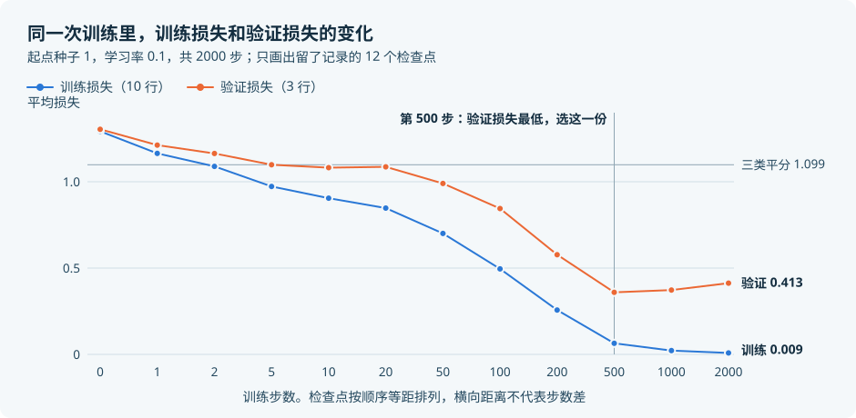

# K01-10 学得怎样

上一章做了一次更新：算出每个参数的变化率，各挪一小步，损失降了一点。把这一步重复很多次，就是训练。

这一章实际训练一遍，然后回答一个比“损失降了没有”更要紧的问题：**训练用的那几行变好了，没见过的行也好吗？** 用的正是第 04 章回放过的那份记录。当时只能照着字面读，现在里面的每个数你都知道是怎么算出来的了。

本章没有新的算术。要做的是读数、比较、划清结论的范围。章末有阶段二的阶段检查。

<a id="loop"></a>

## 把一次更新重复两千次

**这节在干嘛**　看训练循环长什么样，实际跑一遍，读懂记录里训练数据那两列。

训练循环就是上一章那两步套上一个循环：

```python
def train(parameters, rows, learning_rate, steps):
    for step in range(steps):
        slopes = gradient(parameters, rows)                      # 用当前的参数，算全部变化率
        parameters = update(parameters, slopes, learning_rate)   # 所有参数一起挪一步
    return parameters
```

循环之外有几样东西要人事先定下来，它们不是学出来的：

| 定什么 | 这次定的是 |
| --- | --- |
| 从哪里出发 | 按种子 1 取的 27 个小随机数 |
| 学习率 | 0.1 |
| 走多少步 | 2000 步 |
| 每一步用哪些数据 | 全部 10 行训练数据 |

按[课程导读的实验准备](../ABOUT.md#lab-setup)进入仓库根目录，运行：

```bash
python3 v2/10-training/lab.py
```

这条命令真的把 2000 步重新训练一遍，用时不到一秒，再把结果与随课保存的记录逐项比较。输出的最后会写明两者是否一致。

```text
步数    训练损失  训练正确  验证损失  验证正确
    0   1.2919     2/10    1.3038     1/3
    1   1.1640     3/10    1.2118     0/3
    2   1.0888     4/10    1.1637     1/3
    5   0.9726     6/10    1.0983     1/3
   10   0.9047     6/10    1.0814     1/3
   20   0.8474     6/10    1.0864     1/3
   50   0.7007     7/10    0.9900     1/3
  100   0.4951     9/10    0.8448     2/3
  200   0.2568    10/10    0.5773     2/3
  500   0.0643    10/10    0.3597     2/3  ← 验证损失最低，选这个
 1000   0.0223    10/10    0.3728     2/3
 2000   0.0087    10/10    0.4128     2/3
```



先只看训练的两列。训练损失从 1.2919 降到 0.0087，表里的 12 个检查点一个比一个低；训练的 10 行从答对 2 行到第 200 步全部答对。更新在起作用。

表里只列了 12 个检查点。逐步去看，2000 步里有 349 步的训练损失比前一步略高一点，随后又降回去。这不是出了错。上一章说过，变化率只是眼前一小步的近似，步子迈出去以后，损失不保证每一步都降。看趋势，不看单独的某一步。

中间发生了什么，可以停在某一步逐行看：

```bash
python3 v2/10-training/lab.py --at 0
python3 v2/10-training/lab.py --at 10
python3 v2/10-training/lab.py --at 100
```

- **第 0 步**，随机的起点：10 行全选类别 0。碰巧有 2 行的标签是 0。
- **第 10 步**：10 行全选类别 1，答对 6 行。各行的概率其实已经不一样了：a=0、b=3 给类别 1 的是 0.625，a=3、b=3 是 0.409。只是最大的都还是类别 1。
- **第 100 步**：答对 9 行。剩下没对的是 a=1、b=1，正是第 07 章那三行里夹在中间的一行。
- **第 200 步**：10 行全对。

<a id="baselines"></a>

## 两个不用学的参照

**这节在干嘛**　一个成绩好不好，要和不费力就能做到的成绩比。先立两个参照。

**参照一：总选最多的那一类。** 训练数据里类别 1 有 6 行，最多。一个不看输入、永远回答类别 1 的程序，训练 10 行对 6 行，验证 3 行对 1 行，留出 3 行对 1 行。

**参照二：三类各给三分之一。** 一个永远平分概率的程序，损失是 1.0986，第 08 章见过。

这样不用学习就能得到的成绩，叫**基线**。拿它们对照刚才的表：

- 第 0 步，网络答对 2 行，损失 1.2919。两个参照它都不如。随机的起点比“什么都不知道”还差一点。
- 第 5、10、20 步，网络都是答对 6 行，10 行选的都是类别 1。分类的结果和参照一完全一样。上一节看到，这时各行的概率已经有了差别；只看正确行数，看不到这些差别。
- 表里到第 50 步，它才超过参照一。

没有基线，“10 行对了 6 行”听上去像是学到了一半多。有了基线才看得出，那时它选出来的结果，和一个不看输入的程序没有两样。第 03 章里“一律拒绝也能通过 4 题”是同一个道理。

<a id="three-sets"></a>

## 三组数据各看什么

**这节在干嘛**　把第 04 章讲过的三种用途，落到这份记录的具体数字上。

**训练数据：看更新有没有起作用。** 损失降了，行数涨了，说明模型越来越贴合这 10 行。它不回答模型对新输入做得怎样，因为模型就是照着这 10 行调的。

**验证数据：用来选。** 训练途中留了 12 份参数。验证损失在第 500 步最低，是 0.3597，于是选这一份。输出里列出了它在验证 3 行上的表现：

```text
第 500 步的参数在验证的三行上：
  a=0 b=1　正确类别 0　概率 [0.467, 0.532, 0.000]　选 1　错
  a=1 b=3　正确类别 1　概率 [0.000, 0.990, 0.010]　选 1　对
  a=2 b=3　正确类别 2　概率 [0.000, 0.265, 0.735]　选 2　对
```

错的是 a=0、b=1：它给正确的类别 0 分了 0.467，给类别 1 分了 0.532，差得不多，选错了。

**留出数据：方案定了以后才看。** 选定第 500 步之后，第一次用留出的 3 行：

```text
  a=1 b=0　正确类别 0　概率 [0.742, 0.247, 0.011]　选 0　对
  a=2 b=1　正确类别 1　概率 [0.175, 0.746, 0.079]　选 1　对
  a=3 b=2　正确类别 2　概率 [0.003, 0.127, 0.870]　选 2　对
```

把选定的方案和两个参照放在一起：

| | 训练 10 行 | 验证 3 行 | 留出 3 行 |
| --- | --- | --- | --- |
| 选定的第 500 步 | 10/10，损失 0.0643 | 2/3，损失 0.3597 | 3/3，损失 0.2436 |
| 参照一：总选类别 1 | 6/10 | 1/3 | 1/3 |
| 参照二：三类平分 | 损失 1.0986 | 损失 1.0986 | 损失 1.0986 |

可以这样说：**这一次运行，训练的 10 行全部答对；用来选检查点的验证 3 行答对 2 行；选定以后才检查的留出 3 行全部答对。正确行数超过了“总选类别 1”，平均损失低于“三类平分”。**

三组要分开说。验证的 3 行参与了“选第 500 步”这个决定，不能再和留出的 3 行合在一起，当成 6 行没见过的数据。

还有两句不能说。不能把这几行的结果当成一个稳定的准确率：留出只有 3 行，错一行就差 33 个百分点，这些数只能描述这一次运行。也不能说“这个网络学会了规则”：它在 a=0、b=1 上就没做对。后面还有两节会进一步收窄这个结论。

<a id="underfit"></a>

## 连训练数据都没做好：欠拟合

**这节在干嘛**　认识第一种“没学好”，并分清它的两个原因。

模型在训练数据上都做不好，叫**欠拟合**。这份材料里能看到两种原因，对策完全不同。

**训练得不够。** 第 50 步时，网络在训练数据上只对 7 行。接着训练，到第 200 步就全对了。这种欠拟合，多走几步就能解决。

**模型装不下。** 把网络换成第 05 章那种只做乘加的模型，用同样 10 行训练数据训练 5000 步：

```bash
python3 v2/10-training/lab.py --linear
```

```text
线性模型训练 5000 步以后：训练 8/10 行正确，平均损失 0.3434。没分对的行：[[1, 1], [2, 2]]
```

10 行只对 8 行，其中没对的就有 a=1、b=1。第 07 章已经说明了原因：a=0、b=2 和 a=2、b=0 选对了，夹在中间的 a=1、b=1 就一定选错。这不是步数的问题：再加多少步，这 10 行也不可能全部做对。要全对，得换模型的结构，或者换输入的表示。

怎样排查：先看训练损失是否还在明显下降。还在降，接着训练可能有用。早就不降了却还是做不好，原因就不止一种：可能是模型的结构或输入的表示不够用，也可能是起点或学习率不合适，或者有的单元一直被 ReLU 关着。后面“换一个起点再训练”一节里，就有同一种结构训练不好的例子。只凭一条曲线，断定不了是哪一种。这里敢说线性模型是“装不下”，依据是第 07 章那三行的论证，不是这条曲线。

<a id="overfit"></a>

## 训练数据上还在变好，别处不再跟着好：过拟合

**这节在干嘛**　认识第二种“没学好”。它藏在训练损失很漂亮的时候。

回到那张表，这次看第 500 步以后：

| 步数 | 训练损失 | 验证损失 | 验证正确 |
| ---: | ---: | ---: | --- |
| 500 | 0.0643 | 0.3597 | 2/3 |
| 1000 | 0.0223 | 0.3728 | 2/3 |
| 2000 | 0.0087 | 0.4128 | 2/3 |

训练损失还在降，从 0.0643 降到 0.0087。验证损失却掉头往上走了。

原因可以落到一行数据上。验证里选错的那一行 a=0、b=1，第 500 步时模型给正确类别的概率是 0.467，到第 2000 步只剩 0.381。模型为了把训练的 10 行贴合得更紧，把参数推得更远，在这一行上错得更有把握了。这正是第 08 章说的那种被重罚的情况。

模型越来越贴合训练数据，在没参与训练的数据上却不再变好、甚至变差，叫**过拟合**。

读这个例子要有分寸：

- **这是一次真实的观察，不是规律。** 验证只有 3 行，回升的幅度也不大。它说明过拟合长什么样，不说明训练到多少步一定会出现。
- **选对的行数没有变**，一直是 2/3。只看行数会完全错过这个变化；损失看得见。
- **它解释了为什么要用验证数据来选**，不能一路训练到训练损失最低。训练损失最低的是第 2000 步，验证损失最低的是第 500 步。

欠拟合和过拟合合起来，是判断“学得怎样”的基本框架。下表写的是两者的典型表现：

| | 训练数据上 | 没参与训练的数据上 |
| --- | --- | --- |
| 欠拟合 | 做不好 | 通常也做不好 |
| 过拟合 | 做得很好，而且越来越好 | 不再变好，或者变差 |

**可以在这里停一下。** 到这里，一次训练的记录已经读完了：三组数据各看什么，两种“没学好”各长什么样。后面三节换了角度：换起点重新训练，看训练得到的参数，再把阶段二和阶段一接起来。

<a id="seeds"></a>

## 换一个起点再训练

**这节在干嘛**　前面所有数字都来自同一次运行。看看换一个起点，它们还剩多少。

种子决定了那 27 个随机的起点。这一节单独看起点的影响：其他设置都不变，换 20 个种子各训练一遍，统一比较第 2000 步的结果，不再用验证数据挑检查点。这里没有用验证数据做任何选择，所以验证和留出的 6 行在这张表里都算没参与训练的行，可以合起来数。这张表只用来看起点的影响，不用来挑种子：照着它挑了种子，这 6 行就又参与了选择。这条命令要运行几秒钟：

```bash
python3 v2/10-training/lab.py --seeds 20
```

输出按结果分组，列出每一种结果出现了几次。归起来是这样：

| 第 2000 步的结果 | 20 次里的次数 |
| --- | ---: |
| 训练 10 行全对 | 12 |
| 验证 3 行和留出 3 行全对 | 0 |
| 验证和留出合计对 5 行，这是最好的成绩 | 6 |
| 训练对 6 行、验证对 1 行、留出对 1 行，行数与“总选类别 1”相同 | 2 |

- **20 次里只有 12 次把训练的 10 行全部做对。** 有 2 次的正确行数和“总选类别 1”的参照一样。同一种结构，换个起点就可能训练不好。
- **验证和留出的 6 行，没有一次全对。**
- **前面细读的那次运行，落在结果较好的一边。** 种子 1 训练到第 2000 步，这 6 行对 5 行，是 20 次里最好的成绩，一共 6 次做到，它是其中之一。只看那一次，会把这个网络估计得偏好。

由此得到两条更可靠的结论。

**训练的结果依赖起点。** 同样的数据、同样的结构、同样的步数，结果可以差很多。报告一次训练的结果时，要说明设置；只训练一次得到的好成绩，分量有限。

**10 行数据定不下规则。** 能把这 10 行全部做对的做法有很多种，它们在另外 6 行上各不相同。训练找到的是其中一种，不保证是我们心里的那条规则。第 07 章的手设参数证明了这种结构装得下正确的规则；这里看到的是，从 10 行数据出发的训练并不总能找到它。对训练数据没有覆盖的输入，模型照样会给出预测；只是这 10 行保证不了那些预测符合我们心里的规则。

<a id="inspect"></a>

## 训练得到的参数长什么样

**这节在干嘛**　兑现第 07 章的一句话：训练出来的隐藏值，通常看不出含义。

```bash
python3 v2/10-training/lab.py --inspect
```

```text
训练得到的参数：选定的第 500 步。四个隐藏单元各自的算式，数字取三位小数：
  h1 = ReLU(-0.366×a -0.005×b -0.406)
  h2 = ReLU(-0.127×a +1.905×b -1.202)
  h3 = ReLU(-1.115×a +0.422×b +2.237)
  h4 = ReLU(-1.887×a +1.882×b -0.004)
```

对比第 07 章手设的那四个：ReLU(a − 1)、ReLU(a − 2)、ReLU(b − 1)、ReLU(b − 2)。手设的每个单元只看一条通道，含义清楚。训练得到的单元没有按我们预设的含义一个一个排好：每个单元把 a 和 b 混在一起，系数也不是整数，看不出哪一个在判断“是否达到 2 次”。可它在 16 行里选对了 15 行。其中一些计算关系还是分析得出来，下面的 h1 就是一例；但只看这张参数表，概括不出它会什么、不会什么。

输出的最后一行还有一件事：

```text
h1 在 16 行上都是 0，它的参数和起点完全相同，训练没有动过它。
```

上一章抽查梯度时见过，h1 在起点上被 ReLU 关着，和它有关的 6 个梯度是 0。梯度是 0，更新就不会动它；它不动，就一直关着。两千步下来，这个单元从头到尾没有参加。这个网络实际上只用了三个隐藏单元。

对大模型，这一点更要紧，那里的参数多出很多个数量级：**只看参数，概括不了模型会什么、不会什么。要了解它的行为，得拿有代表性的输入去测。** 这就是评测在全课里反复出现的原因。

<a id="recap"></a>

## 回头看：训练一个模型，和改一句指令

**这节在干嘛**　把阶段二和阶段一接起来。两件事都是“让结果变好”，改的东西完全不同。

| | 这一章训练小网络 | 第 02 章修改应用 |
| --- | --- | --- |
| 改的是什么 | 模型的 27 个参数 | 给模型的指令和程序的规则。没有训练模型 |
| 靠什么改 | 10 行带标签的数据，加上损失和更新的算法 | 人看了十条题以后改写 |
| 改动留在哪里 | 保存在参数里，通常不能直接当规则来读 | 指令的文字和代码里，可以直接读 |

用第 05 章的话说：训练改的是参数；改指令是改模型的输入；改程序的规则，改的是应用自己的行为。

评测的原则却是同一套，两边都用得上：

- **先固定什么算对，再看结果。**
- **调的时候看过的数据，不能当最后的检查。** 这里是训练和验证数据，那里是十条开发题。
- **和简单的参照比。** 这里是“总选类别 1”，那里是“一律拒绝”。
- **看逐行的结果，不只看总数。**
- **一次的结果不够下结论。** 这里换一个种子结果就变；大语言模型的输出也会变，第 17 章讲。

<a id="checkpoint"></a>

## 阶段检查：改一个参数，先预测再核对

阶段二到这里结束。你已经能跟着一个小网络从输入算到损失，做一次更新，并读懂一份训练记录。合上前面的表，独立完成下面这道题。它没有示范过。

用第 07 章**手设的**那个网络：h1 = ReLU(a − 1)，h2 = ReLU(a − 2)，h3 = ReLU(b − 1)，h4 = ReLU(b − 2)；c = h1 − h2 + h3 − h4；三个分数是 1 − 2c、0、2c − 3。

现在把 h1 的偏置从 −1 改成 −2，也就是 h1 变成 ReLU(a − 2)。别的都不动。

1. 16 行里，哪几行的选择会变？从哪一类变成哪一类？
2. 看 a=2、b=0 这一行，标签是 1。改动之前和之后，四个隐藏值、三个分数各是多少？损失是变大还是变小？把分数变成概率和损失这一步，可以用第 08 章的实验当计算器，例如 `python3 v2/08-loss/lab.py --scores=-1,0,-1 --label 1`。
3. 在改动之后的状态上，只看这一行、只动三个输出偏置。它们各该往大调还是往小调？按学习率 0.3 更新一次以后，这一行会选对吗？

写下你的答案，再运行核对：

```bash
python3 v2/10-training/lab.py --stage-check
```

<details><summary>参考答案</summary><p>1. 改动以后 h1 和 h2 成了同一个算式，h1 − h2 恒为 0，通道 A 不再被计入。a 是 0 或 1 的八行本来就没有计入 A，不受影响。a 是 2 或 3 的八行，c 都少了 1：其中 b 小于 2 的四行从类别 1 变成类别 0，b 达到 2 的四行从类别 2 变成类别 1。八行全部选错，16 行里选对的从 16 行变成 8 行。</p><p>2. 改动之前：隐藏值 1、0、0、0，c = 1，分数 −1、0、−1，正确类别的概率 0.5761，损失 0.5514。改动之后：隐藏值 0、0、0、0，c = 0，分数 1、0、−3，正确类别的概率 0.2654，损失 1.3266。损失变大。</p><p>3. 变化率是三个概率、正确类别的那一个减 1：三个概率是 0.7214、0.2654、0.0132，所以是 +0.7214、−0.7346、+0.0132。类别 1 的偏置该调大，类别 0 和类别 2 的该调小。更新一次，新的偏置是 0.7836、0.2204、−3.0040。这一行的隐藏值全是 0，分数就等于偏置，正确类别的概率升到 0.3576，损失降到 1.0282，但最大的仍是类别 0，还是选错。一步让损失变小了，没有让选择变对；而且真正出问题的 h1 的偏置并没有被改回去，输出偏置只是在别处补偿。</p></details>

<a id="quiz"></a>

## 四道小测：读一份训练记录

<details><summary>1. 训练损失一直在降，验证损失先降后升。该选哪一步的参数？为什么不选训练损失最低的那一步？</summary><p>选验证损失最低的那一步。训练损失只说明模型有多贴合训练数据；过了某一步以后，贴合得更紧并没有让它在别的数据上更好，反而变差。我们要的是模型在没见过的输入上的表现，验证数据是训练过程中唯一能反映这一点的依据。</p></details>

<details><summary>2. 一个模型在训练的 10 行上答对 6 行。“总选类别 1”也是 6 行。这说明什么？还应当看什么？</summary><p>说明它的正确行数不比一个不看输入的程序好。还应当看逐行的结果：如果它也是 10 行全选类别 1，分类的结果就和这个参照一样。各行的概率有没有拉开，行数看不出来，要看损失。</p></details>

<details><summary>3. 只做乘加的模型训练 5000 步，训练数据对了 8 行。再训练 5000 步会全对吗？</summary><p>不会。训练数据里有 a=0、b=2，a=2、b=0 和 a=1、b=1 这三行，第 07 章说明了这种模型在这三行上至少错一行。这是结构的限制，不是训练得不够。要全对，得换结构或换输入的表示。</p></details>

<details><summary>4. 同事训练了一次，留出的 3 行全对，就说“模型学会了规则”。你会追问哪些事？</summary><p>至少四件。留出一共几行：3 行全对的分量很有限。换一个起点再训练结果怎样：本章 20 次里没有一次把验证和留出的 6 行全部做对。留出的数据有没有参与过选择或调整。和简单的参照比怎样。另外，“学会了规则”是比“这几行做对了”强得多的说法，这份证据撑不起来。</p></details>

<a id="next"></a>

## 这个模型吃的是两个数，文字怎样进去

阶段二回答了第 03 章结尾的前一半问题：模型里面是参数和一套算法；参数是用样本一步一步调出来的；学得怎样，要用没参与调整的数据、对照简单的参照去检验。

还剩后一半。这个小模型的输入是两个数，输出是三个类别里的一个。大语言模型的输入是一段文字，输出也是文字。文字怎样变成能做乘加的数？“选一个类别”怎样变成“写出一段回答”？

第 11 章开始阶段三，换一个只有七个词的小例子，从文字怎样进模型讲起。第 11 章的正文还没有发布。
